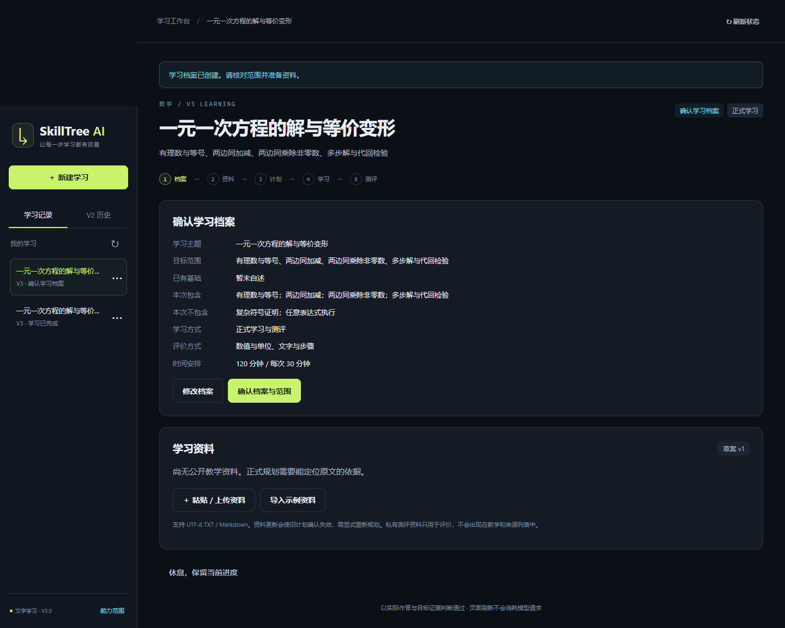

# Day 12 两项前端问题修复

日期：2026-10-21。依据 `work/day12-independent-review-20261021/Day12独立验收报告.md`，仅调整页面脚本，没有修改后端身份、Graph、数据库或模型预算规则。

## 修改

1. **独立新建与同次重试分开。** 本机创建请求仅保留未确认的尝试。成功响应或 GET 确认项目存在后结束该请求，随后同档案新建使用新 UUID。点击新建时先核对旧版遗留缓存；结果未知或项目不存在时继续保留原身份，断连不自动重放 POST。清理前核对项目身份，避免旧响应删除另一标签页的新请求。
2. **忙碌状态统一恢复列表控件。** `busy()` 同时同步记录切换和更多操作按钮，示例资料导入成功、失败和恢复查询失败后都解除禁用；导入进行时依然阻止并发点击。

## 实际验证

本轮定向运行 **26 passed in 49.78s**，覆盖前端回归、Day 12 公开接口和原 V3 学习接口。日志：[targeted-final.log](work/day12-frontend-repair-20261021/targeted-final.log)。页面和测试脚本的 Node 语法检查通过。本轮未重新运行整个 pytest；独立验收报告中的 829 项是修复前的全量结果，不作为本轮新增通过数量。

8 项前端回归使用独立 Edge 无界面实例，加载实际 HTML/JS，经真实 API、Graph、SQLite 和明确的 Fake provider 操作：

| 场景 | 结果 |
|---|---|
| 网页完成数学 A 的两个依赖节点 → 新建相同档案 B | A 保留两个完成事实、两份试卷；B 新 project_id、新创建身份，回到档案确认；请求档案完全相同 |
| 创建已提交但响应截断 | 先 GET 找回结果，无自动第二次 POST；下一次新建获得新身份 |
| 创建响应和恢复查询都丢失，刷新后再次提交 | 未确认请求身份跨刷新和“新建”保留，两次 POST 的身份与载荷完全相同 |
| 创建请求未送达服务器 | GET 404 后仍保留身份，用户再次提交复用该次请求 |
| 旧版保留成功创建缓存，当前选择另一课程 | 只读核对旧请求结果后结束，重新创建相同档案得到新记录 |
| 示例资料导入成功 | 进行中禁止切换；结束后不用刷新即可切换另一记录、打开重命名菜单 |
| 示例资料导入失败 | 查回状态后恢复切换和菜单，用户可以关闭提示继续浏览 |
| 导入失败且恢复查询也失败 | 仍解除记录及更多按钮禁用，无自动重放写请求 |

逐例截图、通过回执与浏览器请求序列位于 [browser-final](work/day12-frontend-repair-20261021/browser-final)。

本轮没有收费模型请求，不证明真实教学与评分质量；三科案例与第四主题评价仍留给 Day 13。浏览器只使用隔离配置和临时学习库，没有操作用户现有页面；部署五份数据库的前后哈希一致：[保留证据](work/day12-frontend-repair-20261021/runtime-preservation.json)。

## 修改文件与使用

- `app/static/v3.js`：创建请求生命周期、旧缓存核对、统一按钮忙碌状态。
- `tests/test_day12_frontend.py`、`tests/support/day12_frontend.cjs`：8 个实际页面回归，临时服务器与独立浏览器。
- `docs/v3/DAY12_API.md`、`DAY12_ACCEPTANCE.md`、本记录：更新约定与证据入口。

静态脚本无需重启后端；现有页面刷新后加载修复，如浏览器仍缓存旧脚本可按 Ctrl+F5。用户已有课程和进度不需要删除或重建。两项报告问题已完成代码与自动化网页复验，正式 Day 12 结项仍由用户审阅验收结论。
