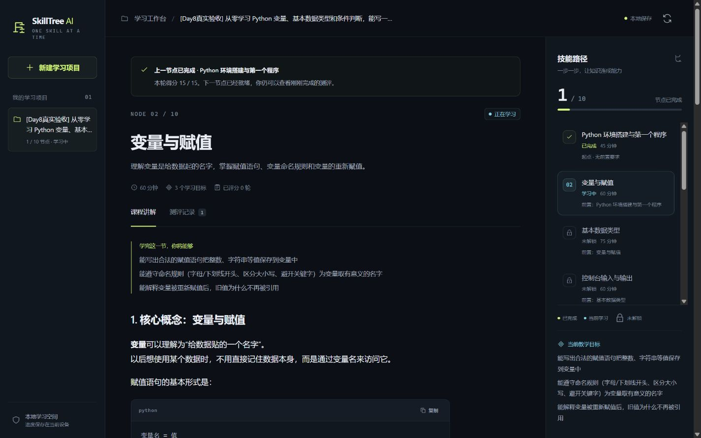
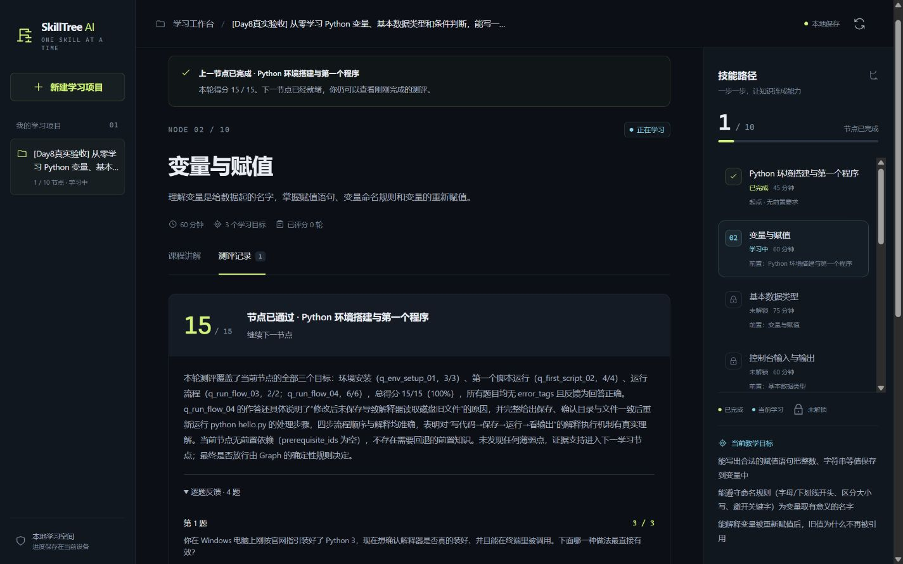
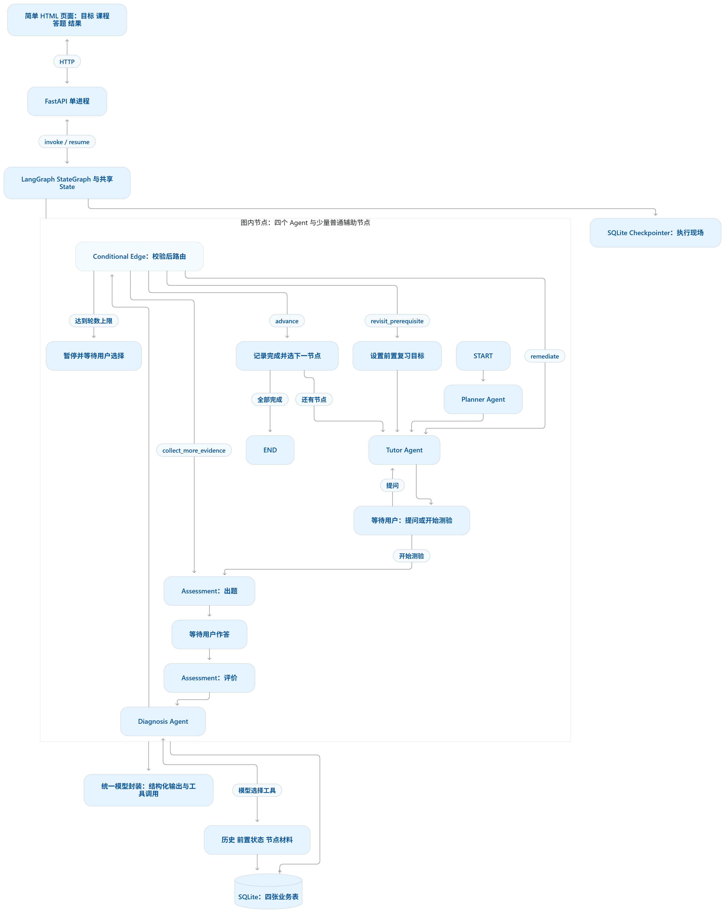

# SkillTree AI Agent 

## 当前启动入口：V3 / Day 12

日常仍运行 `app.py`，默认打开 V3 通用学习工作台：

```powershell
& 'D:/conda_envs/edu_agent/python.exe' 'D:/SkillTree_AI/skilltree/app.py'
```

地址仍为 <http://127.0.0.1:8765/>，服务就绪后自动打开浏览器。若原来的旧服务尚在运行，先在原启动窗口按 `Ctrl+C` 停止，再重新运行。只刷新旧进程的网页不会切换后端版本。

新版流程：开放主题与档案 → 导入资料 → 预览/确认计划 → 学习与测评。V3 运行数据位于独立 `data/v3` 目录，旧记录在“V2 历史”中只读查看，不直接恢复旧版存档。

`day12_server.py` 提供同一新版工作台，默认使用 8012 端口。详见 [Day 12 使用与 API](docs/v3/DAY12_API.md)及[验收记录](DAY12_ACCEPTANCE.md)。启动不会自动迁移已有数据库；全新目录或版本不兼容时，请先按说明显式初始化/迁移。

以下 Day 8 及更早章节保留为历史实现记录，旧版继续学习应使用匹配的 V2 恢复环境。

SkillTree AI 的最终目标是面向**通用学科**的个性化学习系统：将知识组织为有前置依赖的技能图，围绕学习目标提供路径规划、讲解与答疑、测评、诊断、补弱和持续推进。当前版本以 **Python 作为首个验证学科**，先验证完整学习闭环与可靠恢复，再逐步扩展到更多学科。

## Day 8：浏览器学习工作台（历史实现）

现在可以在中文网页中完成新建项目、课程阅读与追问、测验、逐题反馈、补弱和前置复习。深色三栏布局展示真实项目、当前课程与节点依赖；手机通过项目与路径抽屉操作。评分后推进到下一节点，仍可在「测评记录」回顾已结束成绩。





运行 `app.py` 即可启动本地服务，服务就绪后会自动打开浏览器（已用现有 Python 环境验证）：

```powershell
D:\conda_envs\edu_agent\python.exe D:\SkillTree_AI\skilltree\app.py
```

停止服务时，在启动窗口按 `Ctrl+C`。如果浏览器未自动打开，手动访问 <http://127.0.0.1:8765/>。首次换用其他 Python 环境时，先安装 `requirements.txt` 中的依赖。

模型配置沿用本地 `.env`，字段模板见 `.env.example`。不要把密钥填入网页。启动入口固定使用单 worker；同一项目的输入校验与 Graph 执行共用进程内锁。

使用方法：写下 Python 目标 → 生成路径 → 阅读或追问 → 开始测验 → 填写选项与多行答案 → 提交。后端根据评分和诊断决定补弱、追加测评、前置复习或下一节点；前置复习可以返回原考核节点。达到轮数上限后，可以休息或主动再试 3 轮。

答题期间返回教学会放弃旧卷，下次生成新题。草稿按项目与测验身份保存在当前浏览器会话中。刷新或服务重启后，从项目列表继续；同一个测验会恢复原卷。网络响应丢失时，页面先查询已保存状态，不自动重放操作。

学习与答题的新输入身份由独立 Graph 节点持久化，API 拒绝重复或过期输入。旧版本没有输入标识的 Checkpoint 会展示升级说明；已有成绩保留，可继续使用原命令行入口，或新建网页项目。业务库缺失对应 Checkpoint 时不重新规划覆盖。

页面使用本地 CSS、内联 SVG 与安全 DOM Markdown 渲染，无外部页面资源和前端构建系统。公开接口不包含答案、评分规则、内部 State 或工具消息。测试与视觉验收见 [DAY8_ACCEPTANCE.md](./DAY8_ACCEPTANCE.md)。

```powershell
D:\conda_envs\edu_agent\python.exe -m pytest tests/test_day8_web.py -q
```

可复现的 Fake 浏览器验收入口（独立数据库，不调用真实模型，不能代替真实链路验证）：

```powershell
D:\conda_envs\edu_agent\python.exe -m tests.support.day8_browser_server
```

打开 <http://127.0.0.1:8766/>，目标以 `[Fake验收]` 开头。加入 `[追加]` 或 `[前置]` 可触发对应诊断分支；简答题填写「不知道」并选择错误选项可触发补弱，连续三轮未通过则暂停。

## 系统架构

LangGraph 组织 Planner、Tutor、Assessment、Diagnosis 四类 Agent，按测评与诊断结果决定推进、补弱、追加测评或前置复习。SQLite 分别保存业务记录与执行现场，支持等待用户输入和恢复学习。

[](./docs/assets/skilltree-architecture-v2.png)

点击图片查看高清原图；可编辑的 Mermaid 源图与详细设计见 [V2.0 架构文档](./SkillTree_Agent学习版架构_V2.0.md#2-总体架构与技术栈)。

基于 [V2.0 架构](./SkillTree_Agent学习版架构_V2.0.md)逐步实现的 Python 学习项目。当前已有命令行学习闭环、模型工具诊断、SQLite 业务记录与跨进程执行恢复。

## 快速开始

Day 7 剩余开发已接入：简答评分与最终诊断的结构/业务修复、每节点三轮暂停、统一图步数限制、Tutor 六轮上下文和 JSONL 运行日志。保留 Day 6 的同步 Checkpoint、稳定测验 ID 和结果复用。

继续使用 `day6_restore_demo.py` 启动或恢复项目。第三轮满足通过规则正常推进；未通过才进入暂停。休息保存暂停并退出，再次打开仍等待选择；“再试 3 轮”仅增加当前节点上限，原有效轮数不清零。增加额度的独立节点先同步保存，再继续原诊断分支；后续模型故障重试不会再次加额度。

每道简答评分、每次工具选择及最终诊断分别是一个逻辑模型请求，各自最多3次 HTTP（网络重试1次、输出修复1次）；Diagnosis 总工具限制仍是2轮/3次执行。整个测验的题号与 assessment_id 由程序绑定，写入前再次验证题目完整且不重复、分数有限且不越界，程序计算总分。`recursion_limit=30` 只限制一次 Graph 执行步数。

交互日志保存在 `data/day7_events.jsonl`；包含项目/节点/测验 ID、逻辑请求 ID 和次数、耗时、工具及错误类型，不记录模型配置、Prompt、答案或异常正文。详细验收见 [DAY7_ACCEPTANCE.md](./DAY7_ACCEPTANCE.md)。

12个诊断案例（8 debug / 4 holdout）、可运行评价入口和报告模板见 [data/evaluation/README.md](./data/evaluation/README.md)。案例预期均标记待用户复核；Fake 报告仅证明评价流程运行，真实评价由用户复核后手动执行。

当前使用 Python 3.11 验证。在项目目录中创建虚拟环境并安装依赖：

```powershell
py -3.11 -m venv .venv
.\.venv\Scripts\python.exe -m pip install -r requirements.txt
Copy-Item .env.example .env
```

在本地 `.env` 中填写 `LLM_MODEL`、`LLM_API_KEY` 和 `LLM_BASE_URL`，然后启动网页工作台，浏览器会自动打开：

```powershell
.\.venv\Scripts\python.exe app.py
```

原命令行交互演示也可以继续使用：

```powershell
.\.venv\Scripts\python.exe day4_demo.py
```

命令行中可以提问、开始测验、查看反馈并复测。简答题支持多行输入，以单独一行 `END` 结束。运行真实演示会调用配置的模型服务。

## Day 6：跨进程恢复与总验收

直接启动最终交互演示：

```powershell
D:\conda_envs\edu_agent\python.exe day6_restore_demo.py
```

菜单支持“1. 新建项目”和“2. 继续已有项目”。新项目自动生成唯一项目 ID；继续项目从业务库列表选择，使用相同的 `project_id / thread_id` 恢复原执行现场。若业务项目存在但找不到对应 Checkpoint，会明确报错，不能从 START 覆盖旧项目。项目序号输入错误时可重新选择。

也可以用固定 ID 做跨进程验收。先停在教学等待点，再退出整个进程：

```powershell
D:\conda_envs\edu_agent\python.exe day6_restore_demo.py --project-id my_day6_project --goal "学习 Python for 循环" --pause-at-learning
D:\conda_envs\edu_agent\python.exe day6_restore_demo.py --project-id my_day6_project --inspect
```

检查存档不调用模型。教学内容、对话记录和当前节点应保持不变，下一步为 `('wait_learning',)`。继续该项目可以提问或开始测验。若要直接停在答题等待点：

```powershell
D:\conda_envs\edu_agent\python.exe day6_restore_demo.py --project-id my_day6_project --pause-at-quiz
D:\conda_envs\edu_agent\python.exe day6_restore_demo.py --project-id my_day6_project --inspect
D:\conda_envs\edu_agent\python.exe day6_restore_demo.py --project-id my_day6_project
```

`assessment_id`、第一题和整张原卷应相同，下一步仍为 `('wait_answer',)`。公开题面不含 `answer_key / rubric`，原私有试卷保存在业务库与执行存档中。恢复等待点不会再次调用 Planner、Tutor 或出题模型。

每个节点通过后，幂等保存完成事实，按拓扑顺序选择前置条件全部完成的下一节点；只有整棵树完成才结束。进入新节点会清空当前课程、旧 Tutor 对话、试卷、答案、评价和诊断，保留各节点测评轮数。旧轮次从业务库查看：

```powershell
D:\conda_envs\edu_agent\python.exe day6_restore_demo.py --project-id my_day6_project --inspect --assessment-id 原测验ID
```

可以检查原题、答案、Evaluation、Diagnosis、`completed_at` 和 `completion_assessment_id`。不指定测验 ID 时，检查模式自动展示最近一张通过的测验。交互中也会在进入新节点前显示刚完成轮次的评价。

Planner 只生成并校验 State；图先保存 Planner 的 Checkpoint，再执行独立的 `persist_plan` 节点，将 Project/Tree 写入业务库。持久化重试严格检查原目标和技能树一致，不重新规划、不重复插入。

新建、继续输入、失败重试和复用的交互函数均显式使用 `durability="sync"`。图等待本步 Checkpoint 提交完成后才启动下一节点，因此 `assessment_prepare` 生成的测验 ID 必须先可靠保存，再执行出题与试卷业务写入。不能仅依靠独立节点保证这个顺序，LangGraph 默认的异步保存仍存在窗口。

数据库路径由代码位置确定，换工作目录仍使用项目的 `data/checkpoints.sqlite` 和 `data/learning.sqlite`。前者保存执行位置，后者保存项目、树、测验和完成事实。可用 `--checkpoint-db` 与 `--learning-db` 指定两个独立的测试数据库，之后须保持路径一致。连接在所有图操作结束后关闭。

执行失败后使用原项目 ID 加 `--retry`：

```powershell
D:\conda_envs\edu_agent\python.exe day6_restore_demo.py --project-id my_day6_project --retry
```

等待输入用 `Command(resume=...)`；失败重试用 `invoke(None)`，不重新提交答案。业务写入已成功而 Checkpoint 尚未更新时，重试复用原计划、试卷、评分、诊断和完成记录。Ctrl+C 或输入结束均可退出，下次从项目菜单继续。

不带项目 ID 的 `--inspect / --goal / --pause-at-quiz / --pause-at-learning / --retry` 保留 Step 3 的默认项目 `day6_restore_demo`。普通无参数启动进入菜单。完整八项验收步骤与测试对应关系见 [DAY6_ACCEPTANCE.md](./DAY6_ACCEPTANCE.md)。

## Day 6：诊断工具读取真实业务记录

三个只读工具现在按项目和节点查询 `data/learning.sqlite`。历史最多返回最近 3 次有效评分，执行器在查询前排除当前测验；完成状态来自该项目的 `learning_progress`。节点材料保留人工登记的短内容，读取权限由数据库中的节点归属决定。模型只能填写节点和历史条数，不能填写项目、当前测验或数据库路径。

先直接查看实际查询结果，此操作不调用模型：

```powershell
D:\conda_envs\edu_agent\python.exe day6_real_tools_demo.py
```

默认项目为 `day6_demo_project`，节点为 `python_variables`。可以添加 `--project-id 项目ID --node-id 节点ID`，或用 `--exclude-assessment-id 测验ID` 验证当前轮排除。旧演示的空试卷、缺题评分和损坏记录不会作为学习证据；没有有效记录时返回 `no_history`，不是伪造 0 分。

完成一次真实答题和评分后，运行真实模型诊断：

```powershell
D:\conda_envs\edu_agent\python.exe real_diagnosis_demo.py --project-id 你的项目ID --node-id 你的节点ID
```

演示默认使用该节点最新的有效评分；也可指定 `--assessment-id`。当前评分、成绩和技能树来自数据库，历史只在模型申请工具时查询。证据 ID 使用持久化的测验和题目 ID，逐题保留分数、错误标签、证据和反馈；工具不返回私有试卷、`answer_key` 或 `rubric`。无历史、无材料、节点不存在和查询失败有不同状态，并单独传给最终诊断，失败不会注册成学习证据。

回归测试覆盖排除当前轮、两个项目的同名节点历史与完成记录隔离、跨连接稳定证据 ID、有效记录排序和条数限制、旧无效记录跳过，以及空历史和数据库失败向最终模型传递不同状态。

## Day 7 Step 1A：共享模型调用预算

`app/services/llm.py` 提供独立的 `invoke_with_shared_budget`。每个逻辑请求默认最多调用模型 3 次，网络重试最多 1 次，输出修复最多 1 次；两种补救均消耗同一个总预算。校验器通过 `ModelOutputValidationError` 标记可修复的输出，修复请求携带 `RepairContext` 中的原输出和具体失败原因。修复过程中遇到网络错误，再试时保留相同的修复上下文。

模型客户端设置 `timeout=45` 和 `max_retries=0`，关闭底层自动重试。调用器传入的 `invoke_fn` 负责单次请求，校验器负责输出检查。本阶段完成共享预算基础设施，后续步骤再将各 Agent 接入。

```powershell
D:\conda_envs\edu_agent\python.exe -m pytest tests/test_llm_budget.py -v
```

测试覆盖“超时 → 非法 JSON → 修复成功”、持续非法输出停止、修复请求的网络重试、总预算先耗尽、连续网络失败、耗尽预算再次使用，以及客户端的超时和重试配置。

## Day 7 Step 2A：Planner 的结构与业务错误修复

Planner 的 `generate_plan()` 已接入共享预算。结构化解析产生的 JSON/Pydantic 错误，以及原有 `validate_plan_dag()` 检出的重复 ID、缺失前置节点、自依赖和循环依赖，均转换为 `ModelOutputValidationError`，共用一次输出修复额度。网络重试仍最多一次，全部模型请求仍共享 3 次总预算。

修复提示保留原学习目标、8–12 节点要求和完整 JSON Schema，并传入具体校验错误；已取得原计划时还会附上原输出。连续两次输出错误立即停止，不因总预算尚有余额继续生成。模型调用保留 `method="json_mode"`，业务包装器仅捕获 DAG 校验器的 `ValueError`，其他程序错误直接抛出。

`planner_node()` 保留项目 ID、起点选择和纯 State 返回，后续独立的 `persist_plan` 节点负责业务写入。非法计划与失败的修复均不会进入业务数据库。

```powershell
D:\conda_envs\edu_agent\python.exe -m pytest tests/test_planner_repair.py -v
```

测试使用 Day 3 的合法规划 helper，覆盖一次修复成功、两次错误停止、真实 Planner 消息与图执行、合法计划才落库、结构解析错误、网络错误与业务错误共享预算，以及程序错误不触发输出修复。

## Day 7 Step 2B：出题共享预算与旧卷查重

`generate_quiz()` 统一进入 `generate_quiz_with_governance()`；JSON/Pydantic 解析失败、测验或节点 ID 不一致、非法学习目标、漏测目标、卷内重复题和重复旧题共用一次输出修复额度。网络重试最多一次，总请求最多 3 次；不存在单独的重复题生成循环。修复提示保留完整 JSON Schema、固定 ID 和原复测目标，并反馈具体错误。

旧卷来自当前项目、当前节点最近 3 份可读试卷，排除当前测验，包含未评分与 `abandoned` 的已出试卷；也保留当前节点的 State 历史摘要。查重继续使用原有的 Unicode 宽度、大小写和空白标准化，不使用语义相似度。旧卷仅以公开题面摘要进入上下文，答案和评分规则不会进入历史摘要。

出题节点使用 State 指定的业务库和准备节点已保存的轮次，先复用已固定原卷，再决定是否调用模型。新卷通过全部校验后才保存；连续两次错误后保留 `prepared` 记录，`quiz` 仍为空。选择题答案和选项必须对应，学习目标必须完整覆盖，满分必须为有限正数。

```powershell
D:\conda_envs\edu_agent\python.exe -m pytest tests/test_assessment_repair.py -v
```

测试覆盖非法目标与身份修复、卷内与旧卷查重、超时后重复题再修复总计三次、绝不发起第四次请求、结构错误与业务错误共享修复额度、坏卷不落库、原卷复用、数据库历史隔离、放弃试卷与旧数据处理，以及独立演示脚本的测验准备和答案保存流程。

## 自动测试

```powershell
.\.venv\Scripts\python.exe -m pytest -q
```

自动测试使用固定模型结果，并阻止真实模型调用，无需配置模型密钥。测试覆盖规划校验、条件分支、中断恢复、测评与交互演示。

## 当前实现状态

- Planner：结构解析和 DAG 业务错误共用一次修复额度，通过全部校验后写入 State，再由独立节点保存业务记录。
- Tutor：首次教学、追问、补弱，以及指定前置节点的复习和返回当前节点。
- Assessment：先准备稳定 ID，出题的结构与业务错误共用一次修复额度，合格后固定试卷；保存答案再评分，客观题程序判分，简答题模型评价，总分由程序计算，复测查询旧卷避免重复题。
- Diagnosis：有调用预算的只读工具循环、有效证据校验，以及独立的成功、空结果、失败和上限摘要。
- LangGraph：等待用户输入、恢复执行、补弱复测及通过条件检查。
- Day 4 使用 `InMemorySaver` 学习中断流程；Day 6 使用 `SqliteSaver` 跨进程恢复，两者均将业务事实写入 SQLite。
- 诊断工具已经读取真实业务历史和完成记录；人工短材料经过真实项目节点校验后提供。Day 8 已接入 FastAPI 与中文学习工作台。

## 项目范围

- 本地单用户，首版学习 Python 基础的 8–12 个技能节点。
- 使用 Planner、Tutor、Assessment、Diagnosis 四类 Agent，形成规划、教学、测评、诊断、补弱或推进的闭环。
- 后端计划使用 FastAPI、LangGraph、Pydantic；业务记录与执行现场分别保存到 SQLite 业务库和 Checkpoint。
- 前端计划使用一个简单 HTML 页面。

## 目录说明

| 路径 | 预留用途 |
| --- | --- |
| `app/main.py` | API 入口、启动资源、输入校验和公开响应 |
| `app/state.py` | 共享 State 与消息合并规则 |
| `app/graph.py` | 图结构、条件路由、等待和推进节点 |
| `app/agents/` | 四类 Agent 的职责实现 |
| `app/tools/` | 历史、前置状态与节点材料的只读工具 |
| `app/models/schemas.py` | 规划、试卷、评价和诊断的数据契约 |
| `app/db/repository.py` | 项目、节点、进度、测验记录和幂等数据库操作 |
| `app/services/learning_session.py` | SQLite 存档连接、新建、读取、输入恢复与失败重试 |
| `app/services/llm.py` | 模型配置、结构化调用与有限重试 |
| `app/static/index.html` | 单页演示界面 |
| `tests/` | 规则、交互和治理测试 |
| `data/` | 课程骨架、短材料及本地数据库文件 |

## 建议实施顺序

1. State、最小图和四个固定输出节点。
2. 等待用户输入、中断与恢复。
3. 结构化规划和 DAG 校验。
4. 教学、出题、评分与复测闭环。
5. Diagnosis 的只读工具调用。
6. SQLite 业务记录与 Checkpoint 持久化。
7. 超时、重试、轮数限制和评价案例。
8. API、单页界面与演示。

依赖版本记录在 `requirements.txt`，模型变量模板见 `.env.example`。真实密钥只保存在本地 `.env`；本地环境、数据库与缓存由 `.gitignore` 排除。
