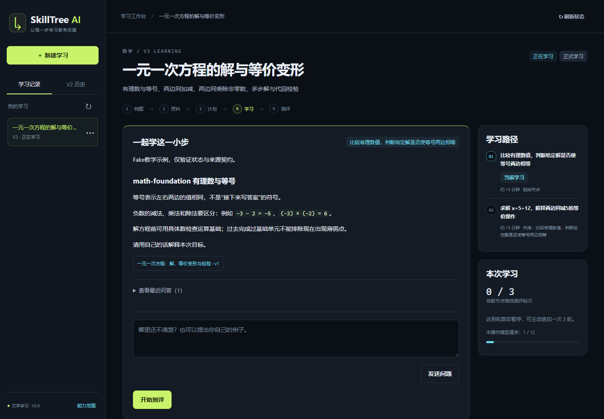
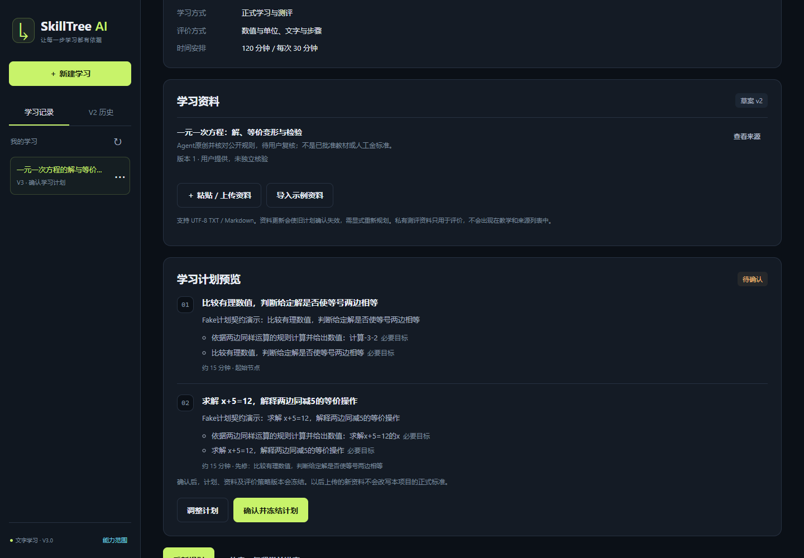
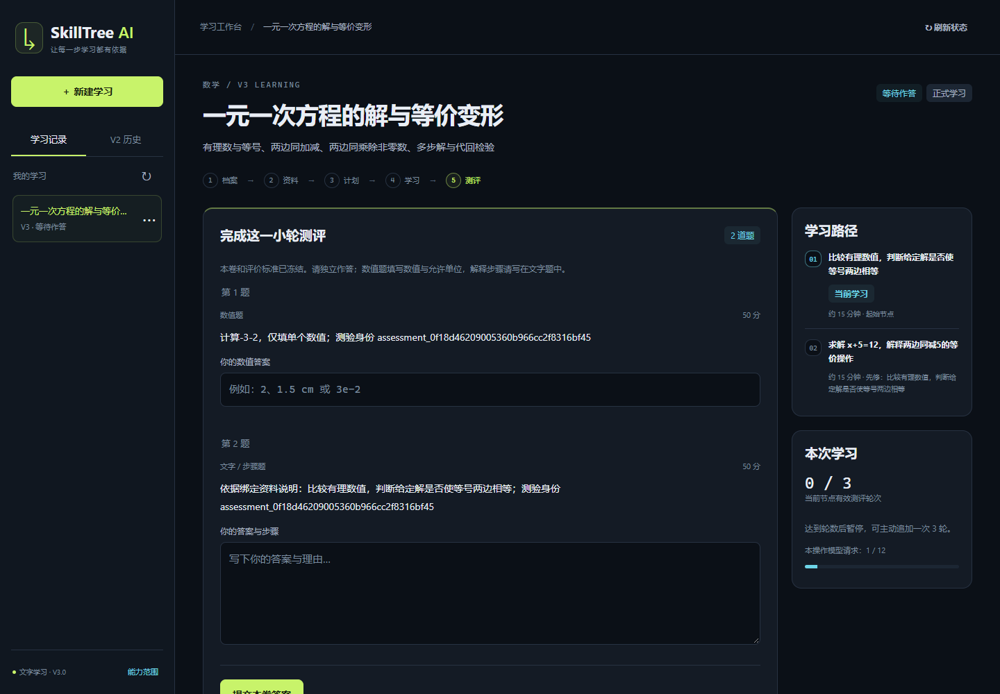
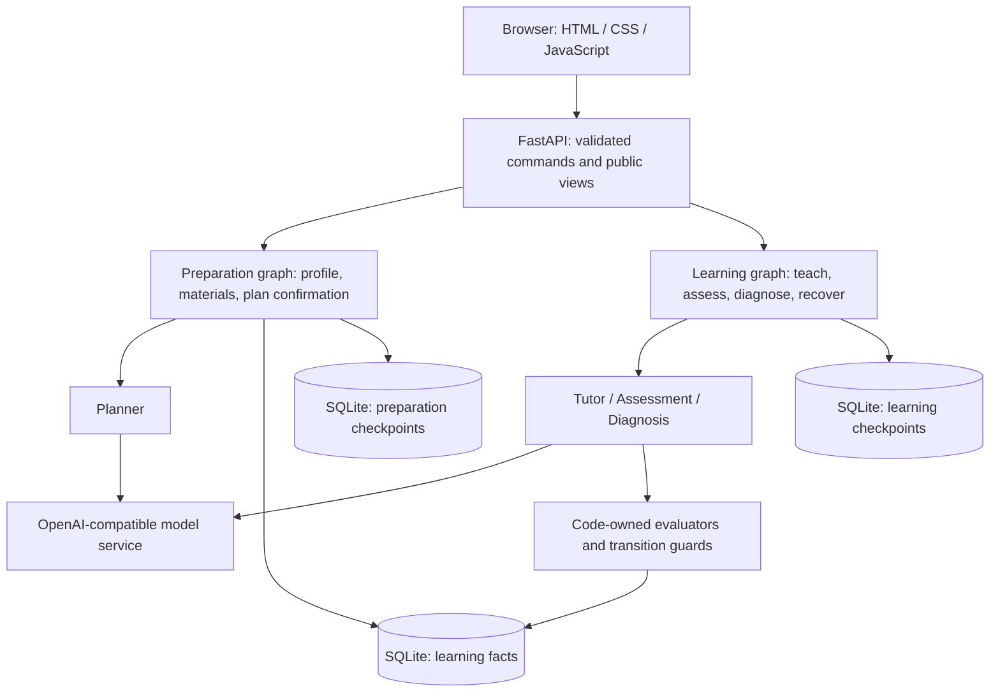

# SkillTree AI

**Turn a learning goal and source materials into a skill path you can study, assess, and resume.**

[English](README.md) · [简体中文](README.zh-CN.md) · [Getting started](docs/GETTING_STARTED.md) · [Development guide](docs/DEVELOPMENT.md)

SkillTree AI is an experimental, local learning agent built with Python, LangGraph, and FastAPI. It connects planning, teaching, assessment, and diagnosis in a dependency-aware learning loop. V3 accepts open-ended text topics and includes Python, mathematics, and English example material packs.

**Current scope:** a local, single-user prototype with a Chinese browser interface. Formal assessment requires supported evaluators, suitable materials, and an explicitly confirmed plan. Content and scoring quality still need independent human evaluation.



*Actual V3 interface, captured from an isolated local run with the repository's Fake model. This demonstrates the working interface and workflow, not real-model teaching quality. [Screenshot details](docs/DEVELOPMENT.md#screenshots).*

## What you can do

| Capability | Implemented in V3 |
| --- | --- |
| Build a learning path | Enter a learning goal and optional prior knowledge. AI proposes a bounded scope and dependency graph; review and adjust it before freezing the plan and assessment policy. |
| Learn from your materials | Optionally paste text or import UTF-8 TXT/Markdown, retaining versions, hashes, and line references. Without teaching materials, AI drafts explicitly labeled notes; goals requiring internal policies wait for the actual documents. |
| Study and ask questions | Read lessons, ask follow-up questions, receive remediation, and revisit prerequisite skills through one entry point. Unsupported practical evaluation is not presented as verified completion. |
| Assess with explicit rules | Use single/multiple choice, restricted numeric answers with supported units, and text answers evaluated against frozen rubrics. Uncertain or invalid assessments enter review. |
| Progress from evidence | Diagnosis proposes a next action; deterministic guards check objectives, thresholds, prerequisites, and assessment identity before recording completion. |
| Resume reliably | SQLite stores learning facts and separate preparation/learning checkpoints. Saved results and request identities support recovery and reject stale submissions. |
| Manage local records | Rename or delete V3 projects and browse assessment feedback. The V2 history UI entry is removed; existing data and recovery support are retained. |

### Plan first, then assess

| Review the plan | Answer an assessment |
| --- | --- |
|  |  |

*Both screenshots use the same isolated Fake-model demonstration. The current UI is Chinese; this English README does not imply an English UI.*

## Quick start

Use **Python 3.11** and Git. Run these commands from the repository directory. A compatible model service is needed for real planning, teaching, and text scoring; model calls may incur provider charges.

```sh
git clone https://github.com/Dog-Headed/skilltree-ai.git
cd skilltree-ai
```

**Windows PowerShell**

```powershell
py -3.11 -m venv .venv
.\.venv\Scripts\python.exe -X utf8 -m pip install -r requirements.txt
Copy-Item .env.example .env
```

**macOS / Linux**

```sh
python3.11 -m venv .venv
. .venv/bin/activate
python -X utf8 -m pip install -r requirements.txt
cp .env.example .env
```

Fill in all three settings in your local `.env`: `LLM_MODEL`, `LLM_API_KEY`, and `LLM_BASE_URL`. The backend uses an OpenAI-compatible chat model with structured JSON output and tool calling. Keep the key in `.env`; the browser does not collect it.

For a **fresh installation**, initialize the V3 stores, then launch:

```powershell
# Windows PowerShell
.\.venv\Scripts\python.exe -X utf8 day11_storage.py --root data/v3
.\.venv\Scripts\python.exe app.py
```

```sh
# macOS / Linux, with the virtual environment active
python day11_storage.py --root data/v3
python app.py
```

Open **<http://127.0.0.1:8765/>** if the browser does not open automatically. Stop the server with `Ctrl+C`. Initialization is a one-time setup step for a new data directory; existing stores require the explicit backup/upgrade procedure in the [setup guide](docs/GETTING_STARTED.md#existing-data).

In the browser: enter a learning goal and optional prior knowledge → create a record → optionally import materials → let AI prepare the scope and plan → review, adjust, and confirm → start learning → take an assessment. Python, mathematics, and English examples cover different text-based tasks; an arbitrary subject label does not add new evaluation capabilities.

Want to explore without a model key? Use the [isolated Fake-model demo](docs/GETTING_STARTED.md#demo-without-a-model-key).

## Architecture



The model generates content and proposes diagnoses. Application code validates contracts, enforces request budgets, controls available tools, and decides whether a node may pass. Public API views omit private answer keys, rubrics, and raw graph state. Reading a project does not run the model or advance the graph.

See the [development guide](docs/DEVELOPMENT.md) for the V3 source map, API contract, and verification commands. The older V2 design remains in the repository as historical design material.

## Tech stack

| Layer | Technology |
| --- | --- |
| Runtime | Python 3.11 |
| Agent orchestration | LangGraph, LangChain Core, LangChain OpenAI |
| API and validation | FastAPI, Uvicorn, Pydantic |
| Persistence | SQLite, LangGraph SQLite checkpoints |
| Browser interface | Plain HTML, CSS, JavaScript; local assets, no frontend build step |
| Verification | pytest; optional Node.js + Playwright for browser regressions |

Direct dependency versions are pinned in [requirements.txt](requirements.txt). Node.js is only needed for browser test tooling.

## Roadmap

- [x] V3 browser workflow from learning profile and materials to plan, lesson, assessment, and diagnosis.
- [x] Choice, restricted numeric, and rubric-based text evaluators with guarded progression.
- [x] Persistent recovery, input identity checks, bounded model calls, and retained legacy-data isolation.
- [x] Python, mathematics, and English packs with user-approved reference standards and finite-set real-model development and validation.
- [x] Density as a new topic: six reference contrasts, two dependent nodes, and restart recovery.
- [x] Goal-first creation with optional materials and explicitly labeled AI notes.

These finite evaluations do not guarantee quality for arbitrary topics or documents. The current system does **not** execute student code, verify symbolic proofs, or assess audio, pronunciation, images, or physical experiments. It accepts text materials rather than PDF/DOCX imports, and it has no multi-user authentication or hosted service. Complex LaTeX remains readable source text rather than full mathematical typesetting.

## Latest Development

**2026-10-25 · Goal-first creation and optional materials.** Create a record with a goal and optional prior knowledge; AI proposes the scope. The mode selector and V2 history entry are removed. Uploaded files guide the plan; missing organization-specific policy documents are requested rather than invented. Restart the server after updating.

[Read the latest development and verification record](docs/v3/GOAL_FIRST_ONBOARDING.md). The current increment passed 934 automated tests on 2026-10-25; real-model usability checks are reported separately. The user accepted Day 13's finite evaluation and recovery scope on 2026-10-24. Historical reports and frozen evidence remain in the repository.

## Contributing

Issues and focused pull requests are welcome, especially reproducible bugs, setup improvements, and human review of subject materials. Read the [development guide](docs/DEVELOPMENT.md) for offline tests, content-evaluation boundaries, and documentation conventions.
