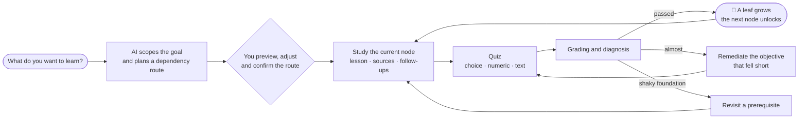
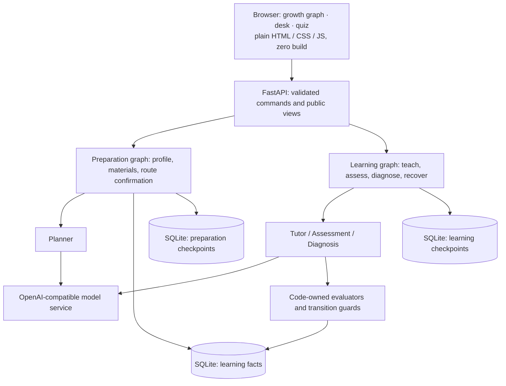

<div align="center">


# SkillTree AI

**Say what you want to learn. Watch it grow into a tree.**

An AI learning agent that breaks a goal into knowledge nodes with real prerequisites,<br>
then teaches, answers follow-up questions and quizzes you, one node at a time.<br>
Every node you pass grows a leaf.

**English** · [简体中文](README.zh-CN.md) · [Getting started](docs/GETTING_STARTED.md) · [Development guide](docs/DEVELOPMENT.md)


<br><br>


<sub>A 12-node route planned by a real model for “learn psychology from scratch”. The soil is what you already know; the higher a node, the more prerequisites it needs. The first node has been passed and grew a leaf; nodes you can study next sprout as buds.</sub>

</div>

---

## Why it is different

- **🌱 Your path is a real dependency graph, not a table of contents.** Every node has prerequisites, observable learning objectives and an estimated duration. When a node needs several prerequisites, their branches merge beneath it.
- **🍃 A leaf grows only when you have actually learned it.** Lessons and follow-up questions lead to a formal quiz; text answers are graded against frozen rubrics. Code-owned guards check objectives, pass thresholds and prerequisites before a node counts as passed. A model's say-so is not enough.
- **🔁 Not passing is not the end.** Diagnosis decides whether to remediate a weak objective, go back to a prerequisite, or collect more evidence.
- **📚 Learn from your own material.** Paste text or import TXT/Markdown; lessons cite line numbers you can open. Without material, the AI drafts clearly labelled notes.
- **💾 Close the laptop; your progress stays.** Learning facts and graph state live in SQLite. Request identities make retries safe: a network drop, a restart or a double click does not count an answer twice.

## How a learning session flows



## A look inside

All screenshots are the real running interface with a real model (2026-10-27, an isolated demo store). The interface is currently in Chinese.

### Every subject grows its own tree


Psychology (12 nodes), Python (12 nodes) and spoken English (9 nodes), each planned by the model from knowledge dependencies. Each subject gets its own leaf and colour: ginkgo for general subjects, fern for programming, flowering vine for languages, pine needles for mathematics. Crowded layers stagger into a crown, so even wide routes keep every label legible.

### The learning desk: read, check sources, ask anything

<table>
<tr>
<td width="64%"></td>
<td width="36%"></td>
</tr>
<tr>
<td>The rail always answers three questions: what you are learning, what you should be able to do afterwards, and how many attempts remain.</td>
<td>Follow-ups are a visible conversation, and the tutor says when an answer goes beyond the material.</td>
</tr>
</table>

### Quiz and result: see exactly where you stand

<table>
<tr>
<td width="50%"></td>
<td width="50%"></td>
</tr>
<tr>
<td>A focused quiz; drafts are saved locally, and missing answers are pointed out by number.</td>
<td>One bar per objective, with the pass line marked. When you pass, the next node sprouts on the graph.</td>
</tr>
</table>

### Your garden · light and dark · phone


<table>
<tr>
<td width="46%"></td>
<td width="54%"></td>
</tr>
</table>

## Quick start

Use **Python 3.11** and Git. Real planning, teaching and text scoring need an OpenAI-compatible chat model with structured JSON output and tool calling; model calls may incur provider charges.

```sh
git clone https://github.com/Dog-Headed/skilltree-ai.git
cd skilltree-ai
```

**Windows PowerShell**

```powershell
py -3.11 -m venv .venv
.\.venv\Scripts\python.exe -X utf8 -m pip install -r requirements.txt
Copy-Item .env.example .env
```

**macOS / Linux**

```sh
python3.11 -m venv .venv
. .venv/bin/activate
python -X utf8 -m pip install -r requirements.txt
cp .env.example .env
```

Fill in `LLM_MODEL`, `LLM_API_KEY` and `LLM_BASE_URL` in your local `.env`. The key stays in `.env`; the browser never collects it.

For a **fresh installation**, initialize the V3 stores, then launch:

```powershell
# Windows PowerShell
.\.venv\Scripts\python.exe -X utf8 day11_storage.py --root data/v3
.\.venv\Scripts\python.exe app.py
```

```sh
# macOS / Linux, with the virtual environment active
python day11_storage.py --root data/v3
python app.py
```

Open **<http://127.0.0.1:8765/>**; stop with `Ctrl+C`. Initialization is a one-time step for a new data directory. Existing stores follow the backup and upgrade steps in the [setup guide](docs/GETTING_STARTED.md#existing-data).

> **No model key yet?** Run the repository's [isolated Fake-model demo](docs/GETTING_STARTED.md#demo-without-a-model-key). It needs no `.env` and makes no paid requests.

## Architecture: the model proposes, code decides



Four roles share the work: **Planner** plans the route, **Tutor** teaches and answers follow-ups, **Assessment** writes and grades quizzes, and **Diagnosis** proposes the next step. The model generates content and proposes diagnoses; application code validates contracts, enforces request budgets, controls the available tools and decides whether a node may pass. Public views omit private answer keys, rubrics and raw graph state. Opening a project only reads it; it never calls the model or advances the graph.

See the [development guide](docs/DEVELOPMENT.md) for the source map, API contract and verification commands.

| Layer | Technology |
| --- | --- |
| Runtime | Python 3.11 |
| Agent orchestration | LangGraph, LangChain Core, LangChain OpenAI |
| API and validation | FastAPI, Uvicorn, Pydantic |
| Persistence | SQLite, LangGraph SQLite checkpoints |
| Browser interface | Plain HTML, CSS, JavaScript; SVG growth graph; self-hosted open-licence fonts; no build step |
| Verification | About 950 offline pytest tests; optional Node.js + Playwright browser regressions |

## Roadmap

- [x] End-to-end browser workflow: goal and materials → route → lessons → assessment → diagnosis
- [x] Choice, restricted numeric and rubric-based text evaluators with guarded progression
- [x] Persistent recovery, input identity checks and bounded model calls
- [x] Goal-first creation, optional materials and clearly labelled AI notes
- [x] Botanical growth graph, learning desk and result page; long multi-session routes
- [ ] **Planned for V4:** PDF / Word knowledge base with RAG citations
- [ ] **Planned for V4:** spoken examples for English and Japanese with speed control
- [ ] **Planned for V4:** interactive charts inside lessons (function plots, data charts, sample candlesticks)

<details>
<summary><b>Current scope (please read before relying on it)</b></summary>

<br>

- A local, single-user prototype with a Chinese browser interface; no multi-user accounts or hosted service.
- Formal assessment requires supported evaluators, suitable materials and a route you have confirmed. Typing any subject name does not add evaluation capabilities.
- The system does **not** execute student code, verify symbolic proofs, or assess audio, pronunciation, images or physical experiments. Materials are text only; PDF/DOCX import is not available yet.
- Text answers are scored by the configured model against rubrics and can be wrong. Valid JSON, valid citations or a completed workflow do not establish teaching or scoring quality; independent human evaluation is still needed.
- In the screenshots, the written answers to the psychology quiz were produced by the model acting as a sample learner to demonstrate the flow; they are not a real learner's results.

</details>

## Latest development

**2026-10-27 · Botanical learning workbench.** The growth graph, garden home, learning desk and feedback now run on the live V3 backend. New trees support multi-session planning; diagnosis context is compacted and model timeouts are selected per task without raising request budgets. Restart the server after updating.

[Read the implementation and publication checks](docs/v3/BOTANICAL_UPDATE_20261027.md).

## Contributing

Issues and focused pull requests are welcome, especially reproducible bugs, setup improvements and human review of subject materials. The [development guide](docs/DEVELOPMENT.md) covers offline tests, content-evaluation boundaries and documentation conventions.

<div align="center">

**If this tree makes you want to learn something, a ⭐ helps others find it.**

</div>
