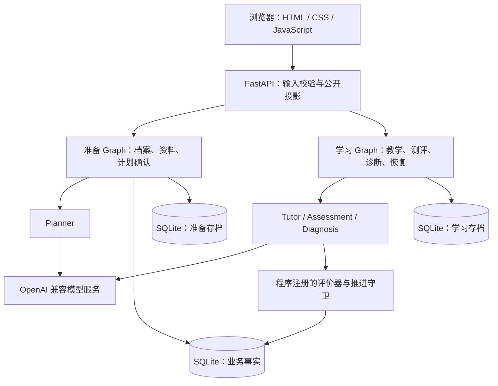

# SkillTree AI

**把学习目标与资料变成一条可以学习、测评、持续推进的技能路径。**

[English](README.md) · [简体中文](README.zh-CN.md) · [安装与使用](docs/GETTING_STARTED.md) · [开发指南](docs/DEVELOPMENT.md)

SkillTree AI 是基于 Python、LangGraph 与 FastAPI 的本地学习 Agent 原型。它以有前置依赖的技能图串起规划、教学、测评和诊断，让学习者可以补弱、复习并恢复进度。V3 接受开放的文字主题，内置 Python、数学和英语三套示例资料。

**当前定位：本地单用户实验原型，网页界面为中文。** 正式测评需要已支持的评价器、适合目标的资料以及用户明确确认的计划。真实教学与评分质量仍需独立人工评价。


*截图来自隔离运行的真实 V3 页面，模型使用仓库自带的 Fake 演示实现，证明界面与流程可运行，不代表真实模型教学质量。[截图说明](docs/DEVELOPMENT.md#screenshots)。*

## 核心功能

| 能力 | V3 已实现内容 |
| --- | --- |
| 规划学习路径 | 只填写学习目标和已有基础（可不填），由AI整理起步范围和依赖计划；预览、调整并确认后冻结计划与评价策略。 |
| 依据资料学习 | 可选粘贴文本或导入 UTF-8 TXT/Markdown，保留版本、哈希和行号引用；不上传时生成明确标记的AI讲义，具体内部制度缺文件时等待资料。 |
| 教学、追问与补弱 | 通过统一入口阅读讲解、追问、补弱，复习前置节点后返回当前目标；未支持的实践评价不会被宣称已经验证。 |
| 按明确标准测评 | 支持单选、多选、受限数值与单位、冻结量规文字评价；不确定评分或无效题进入复核。 |
| 依据作答推进 | 诊断提出下一步建议，程序守卫核对目标、门槛、前置条件与测验身份后才保存完成事实。 |
| 保存与恢复 | SQLite 分别保存业务事实、准备存档与学习存档；复用已保存结果，校验请求身份，拒绝过期提交。 |
| 管理学习记录 | 重命名、删除 V3 项目，查看测评反馈；移除V2历史页面入口，保留原数据与匹配旧环境的恢复支持。 |

### 先确认计划，再进入测评

| 计划预览与确认 | 数值与文字测评 |
| --- | --- |
|  |  |

*两张图均来自同一次隔离 Fake 模型演示。英文 README 是项目说明的翻译，当前网页界面仍为中文。*

## 快速开始

需要 **Python 3.11** 与 Git。真实规划、教学和文字评分还需要支持结构化 JSON 输出与工具调用的 OpenAI 兼容模型服务；模型调用可能产生服务商费用。

```sh
git clone https://github.com/Dog-Headed/skilltree-ai.git
cd skilltree-ai
```

**Windows PowerShell**

```powershell
py -3.11 -m venv .venv
.\.venv\Scripts\python.exe -X utf8 -m pip install -r requirements.txt
Copy-Item .env.example .env
```

**macOS / Linux**

```sh
python3.11 -m venv .venv
. .venv/bin/activate
python -X utf8 -m pip install -r requirements.txt
cp .env.example .env
```

在本地 `.env` 中填写 `LLM_MODEL`、`LLM_API_KEY`、`LLM_BASE_URL` 三项。密钥保留在 `.env` 中，网页不收集密钥。

**首次安装、数据目录全新时**，先显式初始化 V3 存储，再启动：

```powershell
# Windows PowerShell
.\.venv\Scripts\python.exe -X utf8 day11_storage.py --root data/v3
.\.venv\Scripts\python.exe app.py
```

```sh
# macOS / Linux，先激活虚拟环境
python day11_storage.py --root data/v3
python app.py
```

浏览器未自动打开时，访问 **<http://127.0.0.1:8765/>**。按 `Ctrl+C` 停止服务。初始化是新目录的一次性步骤；已有数据请使用[安装指南中的备份与升级流程](docs/GETTING_STARTED.md#existing-data)。

网页操作：填写学习目标与已有基础（可不填） → 创建学习记录 → 可选导入资料 → AI整理范围与计划 → 预览、调整并确认 → 开始学习 → 测评。三科示例覆盖不同文字任务；填写任意学科名称不会自动增加新的评价能力。

不配置模型也能体验[隔离 Fake 模型演示](docs/GETTING_STARTED.md#demo-without-a-model-key)。

## 技术架构



模型生成内容并提出诊断建议；程序校验契约、限制调用预算、控制工具权限并决定节点能否通过。公开 API 不直接序列化私有答案、量规或完整 Graph State。读取项目不会调用模型或推进状态。

V3 源码目录、API 契约与验证入口见[开发指南](docs/DEVELOPMENT.md)。仓库中的 V2 架构设计仍作为历史资料保留。

## 技术栈

| 层次 | 技术 |
| --- | --- |
| 运行环境 | Python 3.11 |
| Agent 编排 | LangGraph、LangChain Core、LangChain OpenAI |
| API 与校验 | FastAPI、Uvicorn、Pydantic |
| 持久化 | SQLite、LangGraph SQLite Checkpoint |
| 网页 | 原生 HTML、CSS、JavaScript；本地静态资源，无前端构建步骤 |
| 验证 | pytest；浏览器回归可选 Node.js + Playwright |

直接依赖版本固定在 [requirements.txt](requirements.txt)。正常运行无需 Node.js。

## Roadmap

- [x] 从学习档案、资料、计划到教学、测评与诊断的 V3 网页闭环。
- [x] 选择、受限数值、冻结量规文字评价，以及受程序守卫控制的推进。
- [x] 持久化恢复、输入身份校验、有限模型调用与新旧运行数据隔离。
- [x] Python、数学、英语资料与用户确认的参考标准，以及有限案例的真实开发和验证。
- [x] 新密度主题六类对照、两个依赖节点与重启恢复。
- [x] 目标优先创建、可选上传资料、明确标记的AI讲义。

有限验收不保证任意主题、任意资料下的教学或评分都正确。当前**不支持**执行学生代码、符号证明、音频与发音、图像或实验过程评价；资料导入仅支持文字，不支持 PDF/DOCX。项目没有多用户认证或托管服务。复杂 LaTeX 保留可读原文，尚非完整数学排版。

## Latest Development

**2026-10-27 · 生长图谱学习界面。** 我的花园、真实技能图谱、学习台和分目标反馈已接入V3后端。新树按多次学习规划；诊断上下文紧凑化，模型按任务选择超时，请求预算保持。更新后重启服务。

[查看最新实现与发布检查](docs/v3/BOTANICAL_UPDATE_20261027.md)。选定46个不同检查项（含16个实际浏览器场景）在适配旧测试的课程地址后均通过；这是流程回归，此前全量与真实模型交接结果单独标注。

## 参与贡献

欢迎提交可复现的问题、聚焦的修复、安装说明改进，以及对学科资料的人工复核。[开发指南](docs/DEVELOPMENT.md)介绍了离线测试、内容质量评价边界和文档维护约定。
