<div align="center">


# SkillTree AI

**说出你想学什么，看它长成一棵树。**

AI 把一个学习目标拆成有前置依赖的知识节点，再陪你一节一节地学、问、测。<br>
每通过一节，就长出一片叶子。

[English](README.md) · **简体中文** · [安装与使用](docs/GETTING_STARTED.md) · [开发指南](docs/DEVELOPMENT.md)


<br><br>

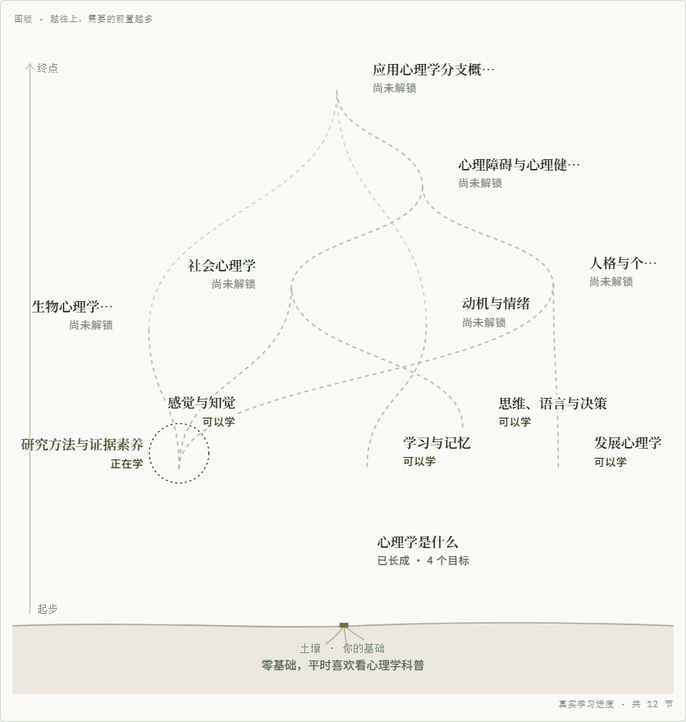

<sub>真实模型为「从零了解心理学」规划的 12 节路线。底部是你的基础，越往上需要的前置越多；第一节已通过，长成了叶子，可以学的节点冒出了新芽。</sub>

</div>

---

## 它和一般的 AI 学习助手有什么不同

- **🌱 学习路线是一张真实的依赖图，不是一列目录。** 每个节点都有前置条件、可观察的学习目标和预计时长。一节需要多个前置时，枝条会在它下面汇合。
- **🍃 叶子只在你真正学会时才长出来。** 讲解和追问之后是正式小测；文字题按冻结的评分标准批改。是否通过由程序守卫核对目标、达标线和前置条件后决定，不由模型一句话说了算。
- **🔁 没通过不是终点。** 诊断会判断下一步是补弱、回到前置知识，还是再收集一次证据。地基不稳时，它会带你先回头补。
- **📚 可以用你自己的资料学。** 粘贴文本或导入 TXT/Markdown，讲解会带行号引用，点开就能看原文。不上传资料时，AI 生成明确标注来源的讲义。
- **💾 关掉电脑，进度还在。** 学习事实与图状态分开存进 SQLite；请求身份让重试是安全的：断网、重启或重复点击都不会把一次作答算两遍。

## 一次学习是怎样进行的

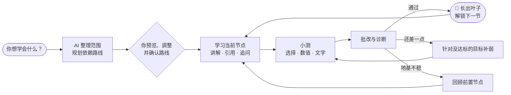

## 看看它的样子

所有截图都来自真实运行的界面和真实模型（2026-10-27，隔离的演示数据库）。

### 每个学科长出自己的树

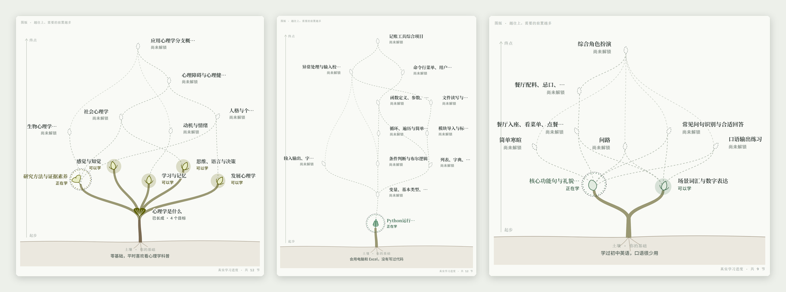

心理学 12 节、Python 12 节、英语口语 9 节，都由模型按知识依赖规划。学科不同，叶形和主色也不同：通用学科用银杏，编程用蕨叶，语言用花藤，数学用松针。节点多的层会错开成树冠，宽图也能看清每个标签。

### 学习台：读讲义、看出处、随时追问

<table>
<tr>
<td width="64%">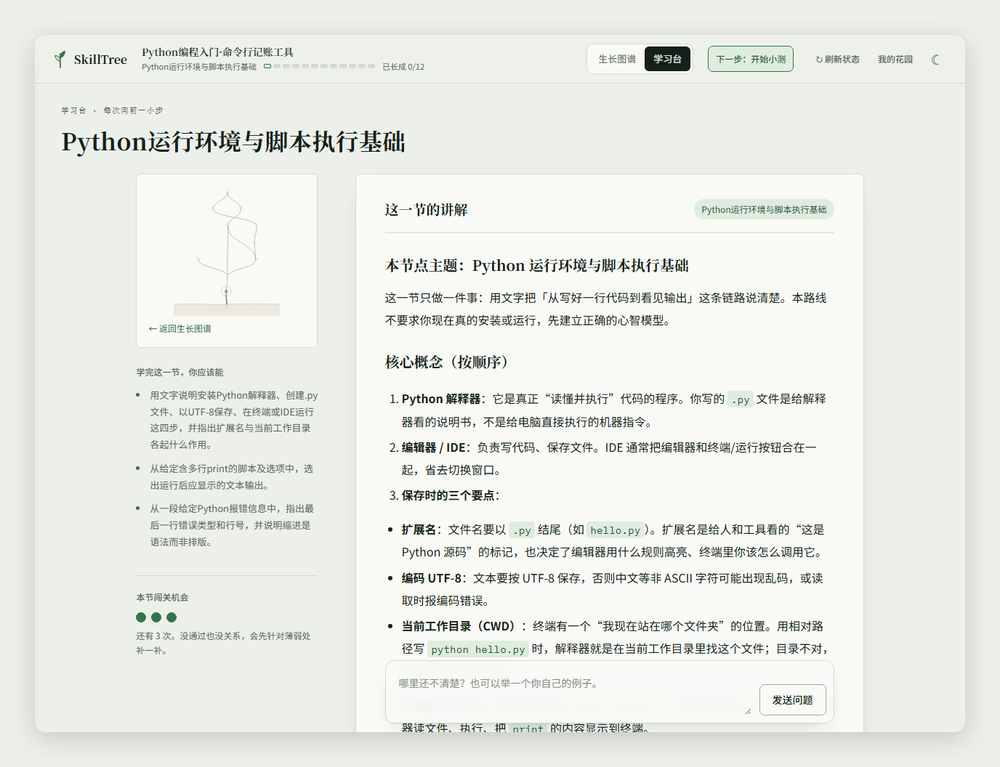</td>
<td width="36%">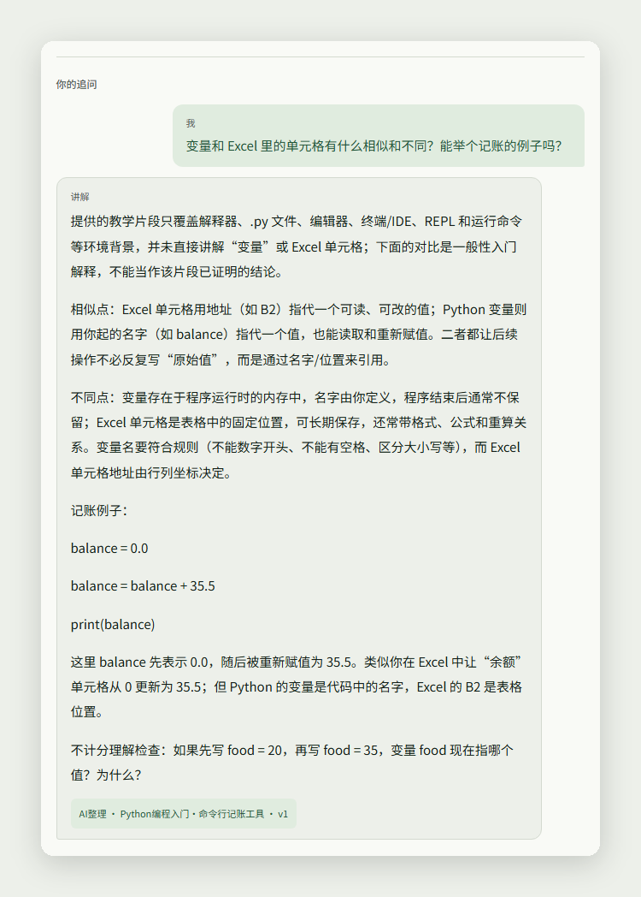</td>
</tr>
<tr>
<td>左侧始终告诉你：在学哪一节、学完应该能做到什么、还有几次闯关机会。</td>
<td>追问是看得见的对话。AI 会说明哪些内容超出了资料范围。</td>
</tr>
</table>

### 小测与结果：知道自己差在哪里

<table>
<tr>
<td width="50%">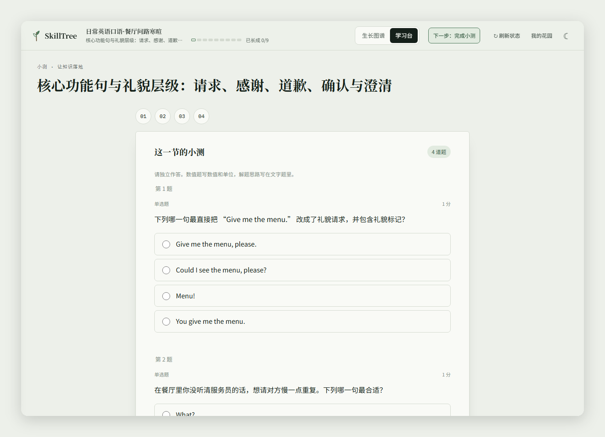</td>
<td width="50%">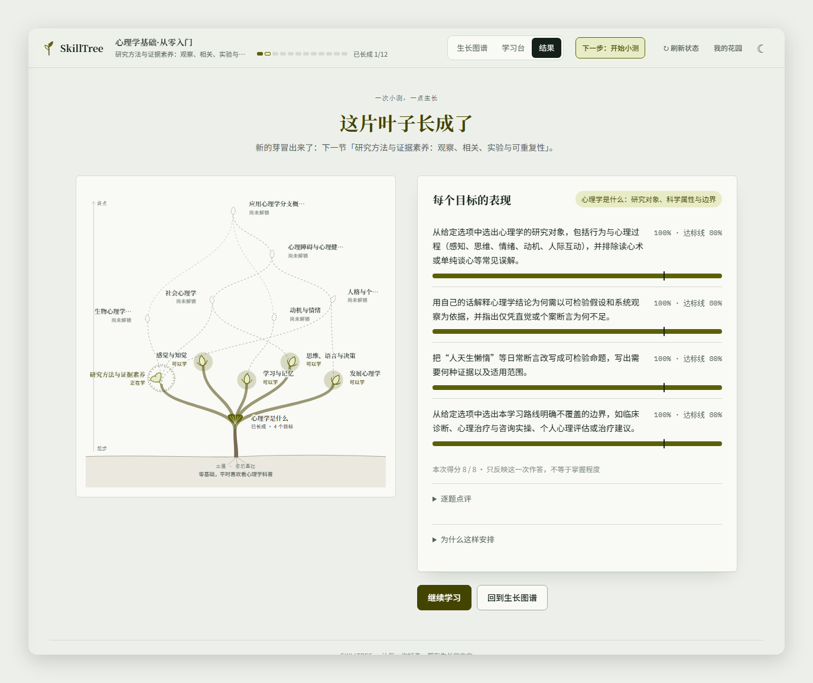</td>
</tr>
<tr>
<td>专注模式作答，草稿自动保存在本机；漏答会提示具体题号。</td>
<td>每个学习目标一条进度条，竖线是达标线。通过时，新节点在图谱上冒芽。</td>
</tr>
</table>

### 我的花园 · 深浅外观 · 手机

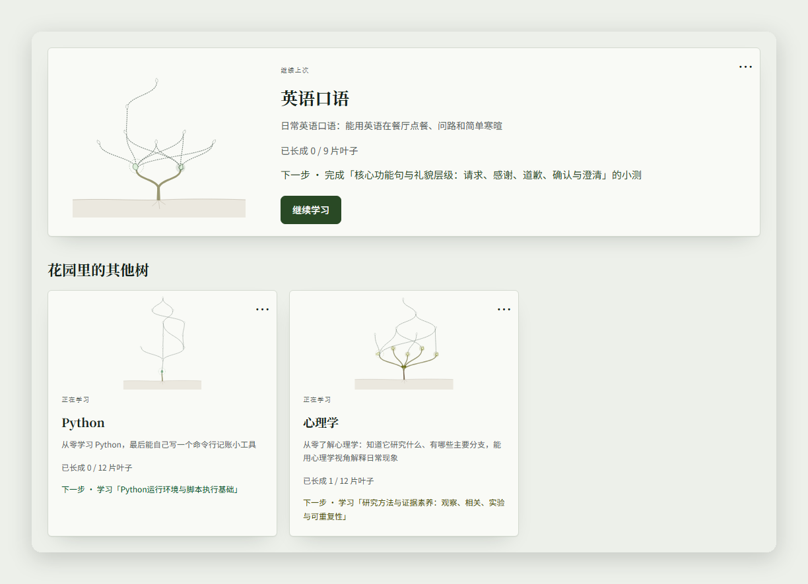

<table>
<tr>
<td width="46%">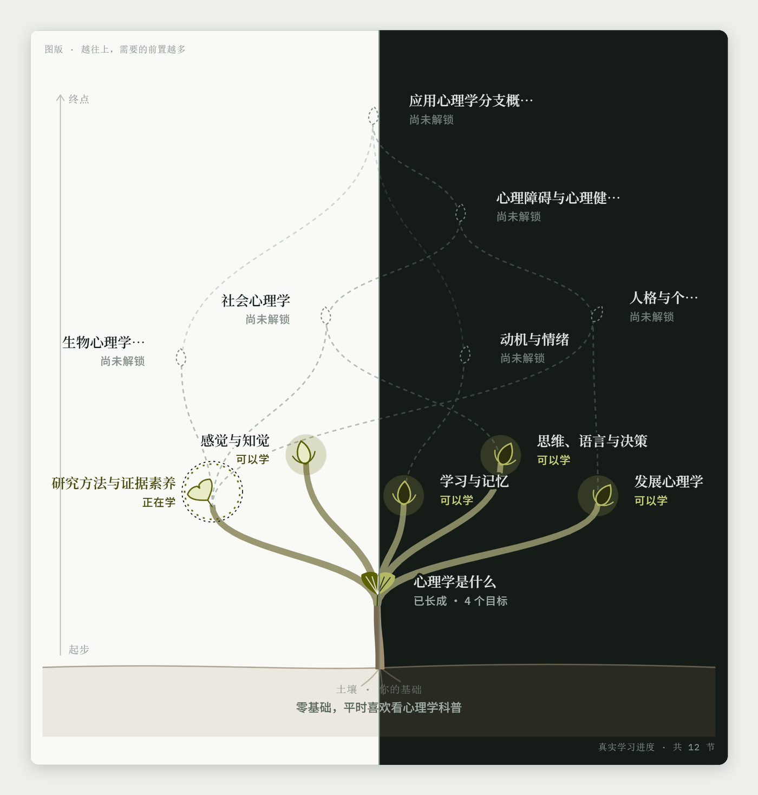</td>
<td width="54%">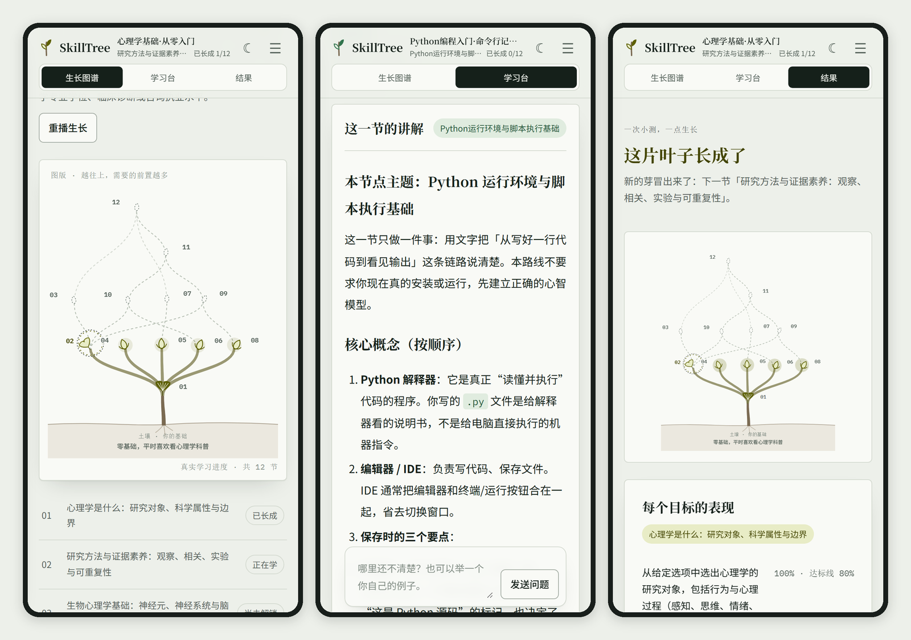</td>
</tr>
</table>

## 快速开始

需要 **Python 3.11** 与 Git。真实规划、教学和文字评分还需要一个支持结构化 JSON 输出与工具调用的 OpenAI 兼容模型服务；模型调用可能产生服务商费用。

```sh
git clone https://github.com/Dog-Headed/skilltree-ai.git
cd skilltree-ai
```

**Windows PowerShell**

```powershell
py -3.11 -m venv .venv
.\.venv\Scripts\python.exe -X utf8 -m pip install -r requirements.txt
Copy-Item .env.example .env
```

**macOS / Linux**

```sh
python3.11 -m venv .venv
. .venv/bin/activate
python -X utf8 -m pip install -r requirements.txt
cp .env.example .env
```

在 `.env` 中填写 `LLM_MODEL`、`LLM_API_KEY` 与 `LLM_BASE_URL`。密钥只保存在本地 `.env`，网页不会收集。

**首次安装**先初始化 V3 数据库，再启动：

```powershell
# Windows PowerShell
.\.venv\Scripts\python.exe -X utf8 day11_storage.py --root data/v3
.\.venv\Scripts\python.exe app.py
```

```sh
# macOS / Linux，已激活虚拟环境
python day11_storage.py --root data/v3
python app.py
```

浏览器打开 **<http://127.0.0.1:8765/>**，按 `Ctrl+C` 停止。初始化只对新的数据目录执行一次；已有数据请按[安装说明](docs/GETTING_STARTED.md#existing-data)备份和升级。

> **没有模型密钥也想先看看？** 运行仓库自带的[隔离 Fake 演示](docs/GETTING_STARTED.md#demo-without-a-model-key)，不需要 `.env`，也不产生费用。

## 架构：模型提出建议，代码做决定

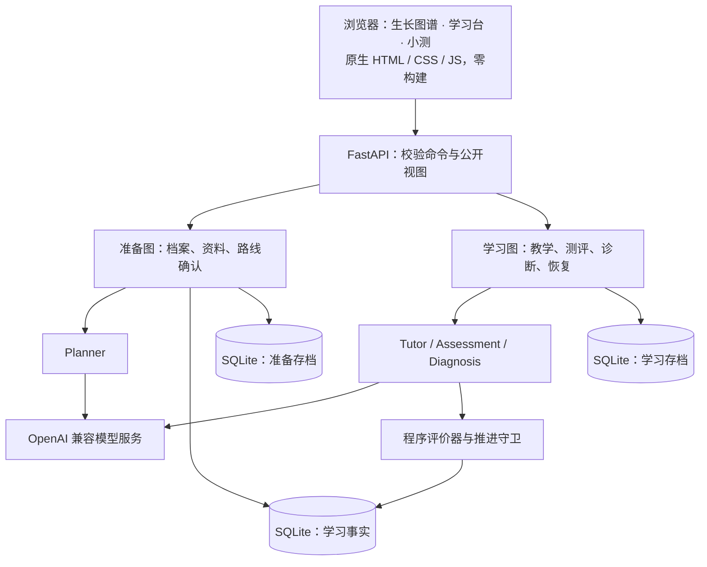

四个角色各管一段：**Planner** 规划路线，**Tutor** 讲解和回答追问，**Assessment** 出题与批改，**Diagnosis** 判断下一步。模型负责生成内容、提出诊断；程序负责校验契约、限制请求预算、控制可用工具，并决定一个节点能否通过。公开视图不包含私有答案、评分量规或原始图状态；打开一个项目只读取，不会调用模型或推进流程。

源码地图、API 契约和验证命令见[开发指南](docs/DEVELOPMENT.md)。

| 层 | 技术 |
| --- | --- |
| 运行环境 | Python 3.11 |
| Agent 编排 | LangGraph、LangChain Core、LangChain OpenAI |
| 接口与校验 | FastAPI、Uvicorn、Pydantic |
| 持久化 | SQLite、LangGraph SQLite Checkpoint |
| 浏览器界面 | 原生 HTML、CSS、JavaScript；SVG 生长图谱；自托管开源字体，无前端构建 |
| 验证 | 约 950 项 pytest 离线测试；可选 Node.js + Playwright 浏览器回归 |

## 路线图

- [x] 从学习目标、资料到路线、讲解、测评与诊断的完整网页流程
- [x] 选择、受限数值与文字量规评价器，配合推进守卫
- [x] 持久恢复、输入身份校验、模型调用预算
- [x] 目标优先创建、可选资料、明确标注的 AI 讲义
- [x] 植物图鉴风格的生长图谱、学习台与结果页，多次学习的长路线
- [ ] **V4 计划中：** PDF / Word 资料知识库与 RAG 引用
- [ ] **V4 计划中：** 英语、日语短句朗读与语速控制
- [ ] **V4 计划中：** 讲义中的交互图表（函数图、数据图、示例 K 线）

<details>
<summary><b>当前能力边界（请在使用前阅读）</b></summary>

<br>

- 本地单用户实验原型，网页界面为中文；没有多用户登录或托管服务。
- 正式测评需要已支持的评价器、适合目标的资料以及你确认过的路线。任意填写一个学科名称，并不会因此多出新的评价能力。
- 系统**不**运行学生代码，不验证符号证明，不评价语音、发音、图像或实验操作。资料目前只支持文字，不支持 PDF/DOCX 导入。
- 文字题由配置的模型按量规评分，可能出错；有效的 JSON、引用或完整流程都不等于教学或评分质量。真实质量仍需独立的人工评价。
- 截图中心理学小测的文字作答由模型扮演示例学习者写出，用于展示流程，不代表真人学习成绩。

</details>

## 最新进展

**2026-10-27 · 植物图鉴学习工作台。** 生长图谱、我的花园、学习台与结果反馈已接入真实 V3 后端。新树按多次学习规划；诊断上下文更紧凑，模型等待时间按任务设置，请求预算不变。更新后请重启服务。

[查看本次实现与发布检查记录](docs/v3/BOTANICAL_UPDATE_20261027.md)。

## 参与贡献

欢迎提交 Issue 和聚焦的 Pull Request，特别是可复现的问题、安装改进，以及对学科资料的人工审阅。离线测试、内容评价边界和文档约定见[开发指南](docs/DEVELOPMENT.md)。

<div align="center">

**如果这棵树让你想学点什么，点一个 ⭐ 能帮更多人找到它。**

</div>
