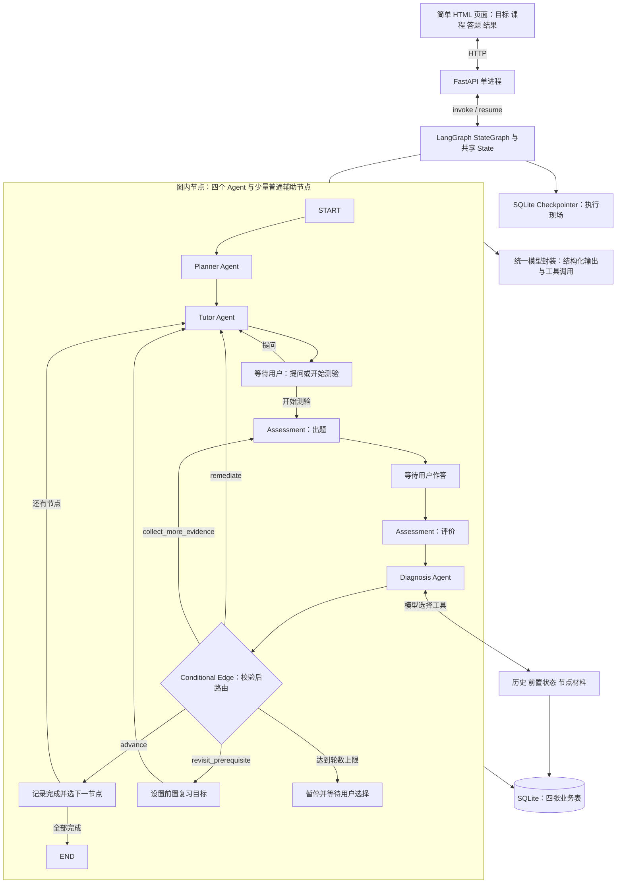

# SkillTree AI Agent 学习版架构 V2.0

日期：2026-09-23。定位：个人学习、可运行演示、AI 应用开发简历项目。
本设计取代 V1.0 的实施路线；旧文档只作参考，不要求同时满足旧版基础设施约束。
本轮仅提供设计、数据契约和少量示意，不生成整个项目代码。

## 1 项目目标与边界

**优先学会 LangGraph 和 Agent 协作，再完成一个小而完整的学习产品。**
即使固定流程可以用普通函数，本项目仍明确使用 LangGraph，以练习 State、Node、Edge、Conditional Edge 和 Checkpoint。
四个 Agent 有独立职责、Prompt 和输出契约；可以共用一个模型，不需要四个服务或四套框架。
首版仅支持 Python 基础，8–12 个技能节点；闭环为目标 → 规划 → 教学 → 测评 → 诊断 → 补弱或推进。
验收示例：学习“列表与循环”，答错累计题，系统指出错误、针对性教学，用户用新题复测后解锁下一节点。
只做本地单用户；节点点亮表示通过当前测评，不宣称永久掌握或精确掌握概率。
删除 V1 的 Worker、租约、SKIP LOCKED、任务队列、复杂版本系统、RBAC 和多租户设计。
暂不做 Redis、RAG、MCP/A2A、向量库、原生 App、代码沙箱；Docker、PostgreSQL 放到完成演示之后。
保留必要的 DAG 验证、答案隔离、有限重试和进度保存，因为它们直接服务学习闭环。

## 2 总体架构与技术栈

[查看高清架构图](./docs/assets/skilltree-architecture-v2.png)。下方保留可编辑的 Mermaid 源图。



后端选择 Python、FastAPI、LangGraph、Pydantic；LangChain 只使用模型适配、消息类型、工具和结构化输出能力。
数据库使用 SQLite：不需要安装服务，足以存小型 DAG 和个人学习记录；简历重点是 Agent 协作、恢复和评价，而非数据库品牌。
首版用标准库 sqlite3 和手写少量 SQL，不加 ORM、Repository 基类或依赖注入框架；数据库函数集中到一个文件。
前端只写一个 HTML 文件，使用少量 CSS/JavaScript；用节点列表、依赖文字和状态标签展示知识图，暂不做 React Flow。
先采用同步 graph.invoke 和普通 def FastAPI 路由，每次执行到下一处 interrupt 就返回；首版不做 token 流式展示。
固定一款实际测试支持 Tool Calling 和 Structured Output 的模型；配置在本地 .env，模型密钥不进入页面、State 或日志。

## 3 四个 Agent 的职责与输入输出

| Agent | 读取 State | 更新 State | 明确边界 |
| --- | --- | --- | --- |
| Planner | goal | tree、current_node_id | 根据 Python 骨架生成 DAG；程序校验后保存；只在新项目执行 |
| Tutor | 当前教学目标、lesson_mode、薄弱点、tutor_messages | lesson、tutor_messages | 首次教学、答疑和针对性补弱；不自行完成节点 |
| Assessment 出题 | 当前考核节点、目标、旧题摘要 | assessment_id、quiz、answers=null、evaluation=null | 固定题目与 rubric 后等待用户，不替用户作答 |
| Assessment 评价 | quiz、answers、assessment_id | evaluation、rounds_by_node | 客观题规则判分，简答调用模型；落库后供诊断使用 |
| Diagnosis | evaluation、当前考核节点、工具返回的少量历史 | diagnosis | 选择工具补充证据，输出四类行动之一；不直接写 completed |

Assessment 的两个 Node 属于同一个 Agent 模块，是为分开“出题、等待用户、评分”；不新增第五个 Agent。
Planner、Assessment、Diagnosis 使用 Pydantic；Tutor 可输出 Markdown。Agent 间传数据对象，不解析彼此的自由文本。
`TreePlan`：nodes，每个节点含 id、title、description、objectives、prerequisite_ids、difficulty、estimated_minutes。
`Quiz`：questions，每题含 id、type、objective_id、prompt、options、answer_key、rubric、max_score；首版默认 4 题。
`AssessmentResult`：assessment_id、逐题 score/max_score、error_tags、evidence、feedback；总分由程序计算。
`DiagnosisResult`：weak_points、evidence_ids、recommended_action、reason、review_node_id 可空。
recommended_action 限定为 advance / remediate / collect_more_evidence / revisit_prerequisite，不接受其他字符串。
Pydantic 禁止额外字段；验证题目/目标/证据 ID、分数范围和前置节点合法性；格式正确不代表教学内容一定正确。
原生结构化输出是否支持取决于模型；应用仍做本地校验，不能靠 Prompt 中“请返回 JSON”保证契约。[官方结构化输出说明](https://docs.langchain.com/oss/python/langchain/structured-output)

## 4 LangGraph State 字段设计

在 state.py 用 TypedDict 定义共享 State；Pydantic 负责验证 Agent 的输入输出，验证后以普通 dict 写入 State。
节点返回局部更新，例如 `{"diagnosis": result.model_dump()}`，不要原地修改整个 State。

| 字段 | 类型与用途 |
| --- | --- |
| project_id | str；业务身份；同一项目对应一个持久 thread_id |
| goal | str；用户目标，创建后固定 |
| tree | list[NodeData]；8–12 个节点，包含 DAG 的 prerequisite_ids |
| current_node_id | str；当前正在考核的节点，复习前置时保持不变 |
| review_node_id | str 或 null；临时要复习的前置；教学目标取它或 current_node_id |
| lesson_mode | normal / remediate / revisit；让 Tutor 知道本次教学意图 |
| lesson | str；当前课程或补弱内容 |
| tutor_messages | list[AnyMessage]；仅 Tutor 对话，用 add_messages reducer 合并 |
| assessment_id、quiz | str 或 null、QuizData 或 null；固定测验标识和服务端完整试卷 |
| answers、evaluation | dict 或 null；本次用户作答及本次结构化评价 |
| diagnosis | DiagnosisData 或 null；薄弱点、证据引用和路由建议 |
| rounds_by_node | dict[str,int]；各节点已完成测评轮数，跨恢复保留 |
| round_limit_by_node | dict[str,int]；每节点初始 3，用户主动继续时可增加 3 |
| user_event | dict 或 null；interrupt 返回的提问、答卷或继续选择 |
| pending_input_id | str；标识当前等待的用户输入，避免双击重复推进 |

除 tutor_messages 外字段默认覆盖；quiz、answers、evaluation、diagnosis 禁止追加 reducer，以免新旧轮次混合。
前进到新节点时清空课程、试卷、答案、评价、诊断和复习目标；轮数映射保留，Tutor 对话用 RemoveMessage 清理旧节点消息。
补充测评保留薄弱目标作为出题依据，但在新卷生成后清空旧 evaluation；补弱保留诊断给 Tutor 使用。
每次 Tutor 调用只取当前节点最近 6 轮完整对话；Diagnosis 使用独立的局部工具消息，不能把私有答案加入 Tutor 对话。
State 保存执行现场，业务表保存可查询事实；历史成绩通过工具按需读取，不把所有历史塞进共享 State。
Reducer、局部更新和条件边是本阶段需要亲手写的核心，而非由通用框架代写。[官方 Graph API](https://docs.langchain.com/oss/python/langgraph/graph-api)

## 5 Node、Conditional Edge 与基础治理

graph.py 注册 planner、tutor、assessment_generate、assessment_grade、diagnosis，以及少量普通辅助 Node。
普通辅助节点只做等待、设置上下文、记录进度或选择下一节点，不调用模型，也不包装成新的 Agent。
用 `add_edge` 表达确定顺序，用 `add_conditional_edges("diagnosis", route_after_diagnosis, mapping)` 展示分支。
route_after_diagnosis 是纯函数，只返回下一节点名称；写库和更新 State 放在相应 Node 中。

| diagnosis 的行动 | 校验和路由结果 |
| --- | --- |
| advance | 评分完整、覆盖全部目标、无关键错误且总分 ≥80 才能进 advance_node；否则改走补充测评 |
| remediate | 设置 lesson_mode=remediate、review_node_id=null → Tutor 按 weak_points 重教 |
| collect_more_evidence | → assessment_generate；新卷优先覆盖缺失目标，再暂停等待答案 |
| revisit_prerequisite | review_node_id 必须在当前节点前置闭包内 → 设置 revisit → Tutor |
| 数据无效 | Diagnosis Node 内最多修复一次；仍无效则报错保留现场；路由函数本身不调用模型，不默认为 advance |

“80 分”是可调整的演示规则；MVP 使用当次测验独立判断，不从历史最高分拼成绩，不把总分显示为掌握概率。
advance_node 幂等记录完成，按拓扑序选择第一个尚未完成且全部前置完成的节点；全完成则 END。
前置复习不修改 current_node_id、不撤销旧成绩；用户点“返回当前节点”后清空 review_node_id，再到 Tutor 补弱原节点。
这里必须保留返回目标，否则系统容易永久停留在前置节点，或误把前置测验当作当前节点通过。
Tutor 输出后进入 wait_learning：用户选择提问、开始测验、返回当前节点；生成题目后进入 wait_answer 等待答卷。
首版测评期间只允许提交或返回教学；返回教学即将该卷 abandoned，下一次生成新卷，避免看过提示后重交同卷。
wait_learning、wait_answer、pause 节点调用 interrupt；模型调用和写库放在前面的独立 Node 中。
每个等待点的 pending_input_id 由前面的节点生成并写入 State；恢复该等待点时保持不变，下一次等待才换新 ID。
恢复必须用相同 thread_id 和 `Command(resume=payload)`；含 interrupt 的节点会从头重跑，所以中断前不做有副作用的工作。[官方 Interrupts](https://docs.langchain.com/oss/python/langgraph/interrupts)

基础治理只保留以下边界，初值可在一次演示后调整：
- 每次模型请求 timeout=45 秒；网络暂时错误最多重试 1 次，鉴权失败不重试；结构校验失败最多修复 1 次。
- 两类重试共用每次逻辑模型请求最多 3 次实际 HTTP 调用的额度，关闭 SDK 的重复自动重试；放在 services/llm.py。
- Diagnosis 工具循环最多 2 轮、总计最多 3 次工具执行，耗尽后禁止继续调用工具，转入结构化诊断或报告证据不足。
- 每次图调用设置 recursion_limit=30，限制一次执行的图步数；它不是整个学习项目的累计轮数限制。
- 每次有效评价后按 assessment_id 去重增加该节点轮数；未达标且到达 round_limit 时先进入 pause，而不是继续自动补弱。
- pause 展示“休息 / 再试 3 轮”；休息继续停留在 interrupt，选择再试才增加上限并按已有诊断继续，已达标仍可推进。
- 记录 project_id、节点名、assessment_id、耗时、工具名、错误类型；不记录密钥，也不要求保存模型隐藏推理。
recursion_limit 作为调用配置的顶层字段；节点循环中的工具次数需要单独计数，不能指望图步数替代。[官方步数说明](https://docs.langchain.com/oss/python/langgraph/graph-api)

## 6 Tool Calling 设计

第一版让 Diagnosis 真正选择工具；Tutor 先直接读取已知节点材料，之后可复用同样的工具循环，无需首版同时实现两套。

| 工具 | 模型可填写参数 | 返回内容 |
| --- | --- | --- |
| get_learning_history | node_id、limit≤3 | 最近成绩、错误标签、诊断、相关答案片段和 evidence IDs；当前轮另从 State 提供 |
| get_prerequisite_status | node_id | 当前项目的前置节点及完成情况 |
| get_node_material | node_id | 人工整理的短材料、材料 ID、目标；不联网、不读取任意文件路径 |

工具用 @tool 声明清晰名称、说明、参数 Schema；project_id 由执行上下文注入，模型不能自行指定其他项目。
执行顺序：bind_tools → 模型返回 tool_calls → 校验名称和参数 → 调用 Python 函数 → 追加对应 tool_call_id 的 ToolMessage → 模型继续判断。
不要在后端固定调用所有工具后宣称是 Agent 自主调用；演示日志应能看到模型选择了哪个工具、参数和返回摘要。
三个工具全部只读；限制 node_id 属于当前项目，工具失败返回明确错误，不伪造历史或空成绩。
为减少兼容性问题，工具收集和最终 DiagnosisResult 分成两个阶段：先有界工具循环，再单独调用结构化输出模型封装。
该循环直接放 diagnosis.py，暂不加子图框架；之后可将它展开成模型 Node 与 ToolNode，练习更细粒度的图编排。
这里学的是模型发起调用、程序执行、结果回传，流程与官方工具示例一致。[官方 Workflows and agents](https://docs.langchain.com/oss/python/langgraph/workflows-agents)

## 7 Memory 与 Checkpoint

短期记忆：State 的课程、当前诊断、Tutor 对话；长期学习记录：SQLite 中的节点成绩、完成情况、历史薄弱点。
先用 InMemorySaver 学会中断恢复，再切换 SqliteSaver，使用独立 checkpoints.sqlite；异步版以后再学 AsyncSqliteSaver。
Checkpointer 在节点执行边界保存状态；同一 project_id 对应固定 thread_id，不为每次 HTTP 请求生成新 thread_id。[官方 Checkpointers](https://docs.langchain.com/oss/python/langgraph/checkpointers)
无需独立 learning_sessions 表：首版一个项目就是一条持续会话，project_id 同时定位业务记录与 Checkpoint。
程序启动时读取已有项目；恢复等待输入用 Command(resume=...)，失败后的待执行节点重试用同 thread_id 的 invoke(None)，不重新走 START。
只在对应状态提供“继续输入”或“重试失败”按钮；不要把普通故障恢复误当成新的学习输入。
业务库与 Checkpoint 不保证共同事务：测验先持久保存，恢复后按 assessment_id 复用已有题目、评分和诊断；完成记录用唯一键 upsert。
测验 ID 在独立准备节点中生成 UUID 并先写入 Checkpoint，再进入出题节点；失败重跑复用 ID，放弃旧卷再出题才生成新 ID。
round_no 仅记录测评次序，不作为唯一键：放弃试卷不消耗有效评价轮数，避免新卷与旧卷共用 ID。
Tutor 重跑可能重复一次模型调用，这是个人版接受的限制；不为消除所有重复调用引入任务调度或租约。
首版不承诺 checkpoint 跨 State 结构升级兼容；开发时保留旧数据备份，用新演示项目验证修改后的 State。

## 8 简化数据库与 DAG

只维护下面四张业务表；LangGraph 自己管理的 Checkpoint 内部表不手写、不作为新增业务模型维护。

| 表 | 主要字段 | 用途 |
| --- | --- | --- |
| learning_projects | id、goal、created_at | 学习目标与固定 thread_id 对应关系 |
| knowledge_nodes | project_id、id、title、description、objectives_json、prerequisite_ids_json、difficulty、estimated_minutes、sort_order | 小型知识 DAG；联合主键(project_id,id) |
| learning_progress | project_id、node_id、started_at、completed_at、completion_assessment_id | 唯一键(project_id,node_id)，保存开始与完成事实 |
| assessments | id、project_id、node_id、round_no、quiz_json、answers_json、evaluation_json、diagnosis_json、status、created_at | 一行保存一轮固定测验及证据；status 为 prepared/awaiting_answer/graded/abandoned |

knowledge_nodes 的前置列表用 JSON 存储，8–12 节点足够；为简化手写实现，不增加 node_dependencies、question、answer 等表。
开启 SQLite foreign_keys；progress 和 assessments 的(project_id,node_id)引用 nodes；JSON 内引用由程序校验。
生成后检查 ID 唯一、依赖存在、无自环、无环、8–12 节点、每节点1–3目标；Python 拓扑排序就够，不需要图库或图数据库。
本版所有节点都是可学习技能，不做章节节点、父子分组或图版本；学习前可整图重生成，开始后要改图就新建项目。
依赖是 DAG，因为“循环累计”同时需要“变量”和“列表”；前置为 AND，不能用单父节点 Tree 替代。
状态在读取时派生：有 completed_at→completed；否则有 started_at→learning；否则全部前置完成→available；其余 locked。
无前置节点立即 available；UI 顺序不代表依赖。项目进度只显示已完成节点数/全部节点数。
已有完成记录不会因复习失败而删除；新项目不自动继承旧项目成绩，不设计复杂迁移。

## 9 最小目录与演示接口

```text
skilltree/
├── app/
│   ├── main.py                    # FastAPI、启动资源、输入校验和公开响应
│   ├── state.py                   # TypedDict State 与消息 reducer
│   ├── graph.py                   # 图、条件边、等待与推进辅助节点
│   ├── agents/
│   │   ├── planner.py             # Prompt、规划与 DAG 验证
│   │   ├── tutor.py               # 教学、答疑与补弱
│   │   ├── assessment.py          # 出题、判分与评分校验
│   │   └── diagnosis.py           # 工具循环与结构化诊断
│   ├── tools/
│   │   ├── history.py             # get_learning_history
│   │   └── knowledge.py           # 前置状态、节点材料
│   ├── models/
│   │   └── schemas.py             # Pydantic 输入输出契约
│   ├── db/
│   │   └── repository.py          # 四张表初始化及具体 SQL 函数
│   ├── services/
│   │   └── llm.py                 # 模型配置、结构化调用、超时和有限重试
│   └── static/
│       └── index.html             # 唯一新增前端目录，完成本地演示所需
├── tests/                         # 规则测试、Fake 模型与小型评价案例
├── data/                          # Python 骨架、材料和本地 SQLite 文件
├── requirements.txt
├── .env.example
├── .gitignore
└── README.md
```

新增 static 是为了看见产品闭环；data 是为了保存课程骨架、材料和持久状态，不是新的架构层。
Prompt 先放对应 Agent 文件，不额外拆 prompt registry；图辅助函数先放 graph.py，不再添加 engine/service 目录。
依赖只安装实际使用的包：FastAPI、Uvicorn、LangGraph、SQLite checkpointer、模型适配包、Pydantic、配置加载包、pytest，并锁定实测版本。
最小接口：POST /projects 创建并运行至首个等待点；GET /projects 列表；GET /projects/{id} 返回图、进度和当前公开画面。
POST /projects/{id}/resume 接收 pending_input_id 与提问/答案/选择；POST /projects/{id}/retry 只恢复失败执行。
API 校验当前等待类型，只允许对应输入；一把进程内锁禁止同一项目同时运行，重复 pending_input_id 返回409并让页面刷新。
仅启动一个 Uvicorn worker，绑定本机地址；网页等待本次调用，不引入轮询任务表、后台 Worker 或分布式锁。
不把完整 State/Checkpoint 返回前端：只给课程、题面和已结束评价；隐藏 answer_key、rubric 和工具内部消息。

## 10 开发顺序与每阶段学习目标

| 阶段 | 亲手实现内容 | 你应学会什么 | 验收 |
| --- | --- | --- | --- |
| 1 第一天 | state.py、最小 graph.py，四个 Agent 用固定 dict 返回 | State、局部更新、Node、Edge、Conditional Edge | Fake 诊断能分别进入四条分支 |
| 2 人机交互 | 等待节点、interrupt、Command(resume)、InMemorySaver | Agent 为什么必须停下来等用户 | 不输入答案绝不进入评分，提问可回 Tutor |
| 3 结构化规划 | schemas.py、Planner、Python DAG 验证，接一个真实模型 | Pydantic、结构化输出、语义校验 | 合法图通过；重复 ID、悬空依赖和环被拒绝 |
| 4 教学与测评 | Tutor、Assessment 出题与评分、固定 rubric | 上下文隔离、生成和评价职责拆分 | 一次答错、补弱、复测通过的闭环 |
| 5 真正工具调用 | 三个只读工具、Diagnosis 工具循环与结构化结果 | tool_calls、ToolMessage、参数与证据校验 | 日志展示模型选择工具，并据返回数据改变诊断 |
| 6 持久化 | 四张业务表、SqliteSaver、稳定测验 ID | Checkpoint 与业务 Memory 的区别 | 重启后在原等待点继续，不重新规划或丢成绩 |
| 7 治理与评价 | 超时、重试、轮数上限、Fake 错误与少量人工案例 | 怎么限制 Agent、验证它是否正确 | 无无限循环、错误评分不误解锁、恢复不重复完成 |
| 8 最小展示 | FastAPI、index.html、README、录屏 | 前后端输入如何驱动图继续执行 | 从目标到两个节点完成可连续演示并解释每条边 |

第一天只写 State、四个固定输出节点与路由测试，不同时开发数据库、前端和真实 Prompt。
阶段4继续用阶段1的固定 Diagnosis 验证接线；阶段5才替换为真正选择工具并给出结构化诊断的 Agent。
每阶段一个可运行小成果；阶段1–2可直接在本地脚本调用图，最后再接网页，避免一开始被 UI 分散注意力。

## 11 最小 Evaluation 与测试

规则测试：DAG 环/悬空引用、双前置 AND 解锁、四种诊断路由、非法 advance、前置复习返回、轮数上限。
交互测试：interrupt 前后输入类型正确、重复提交被阻止、Checkpoint 重启恢复、测验答案不出现在公开响应。
治理测试：Fake 模型返回坏 JSON、超时、不存在的工具、伪造 evidence ID、连续 tool_calls；验证有限退出。
真实 AI 评价先准备 12–20 个人工案例：正确、部分正确、关键误解、证据不足、需要复习前置；留出部分案例不用于调 Prompt。
记录结构合法率、行动与人工预期一致率、错误放行数、工具调用是否合理、耗时和可获得的用量；标明模型与 Prompt 版本。
自动测试默认用 Fake 模型，不消耗密钥；真实评价手动运行。小样本用于发现问题，不宣传未经验证的学习效果提升。

## 12 最终简历亮点与完成标准

实际完成后可写：“基于 LangGraph 构建 Python 技能树学习系统，协同 Planner、Tutor、Assessment、Diagnosis 四类 Agent，通过共享 State 和条件边实现教学、测评、诊断与补弱闭环。”
第二条可写：“使用 Pydantic 校验规划、评分和诊断结果；实现只读工具调用、SQLite Checkpoint 与会话恢复，并加入超时、有限重试、执行步数和测评轮数限制。”
第三条仅在测量后填写：“构建 N 个规则测试与 M 个人工评价案例，验证 DAG 解锁、诊断分支、工具调用和中断恢复，记录错误放行与失败场景。”
面试应能亲自解释：State 如何更新、何时 interrupt、工具由谁执行、为什么诊断建议还要校验、重启从哪里继续。
最终展示一段“答错 → 查询历史 → 定位薄弱点 → 补弱 → 新题通过”的真实轨迹，而不只是四个 Agent 名称和一张图。
完成这条路线后，再选择一个扩展深入学习：将工具循环展开为 ToolNode 子图、增加资料检索，或迁移 PostgreSQL；不要求全部做。
