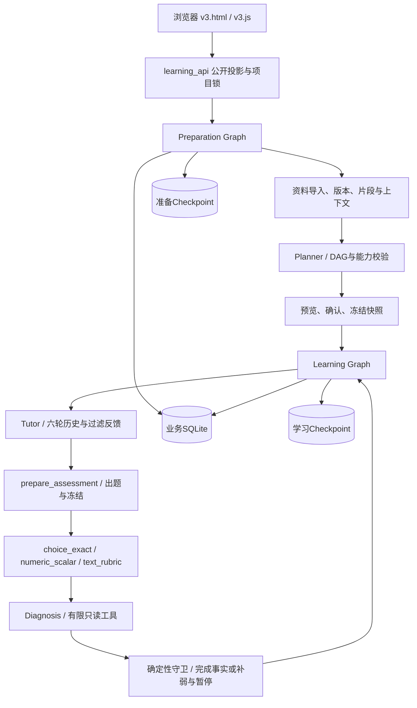

# 当前 V3 实现与边界

此文对应当前工作树，不把 Day 9 的“计划能力”当成已验证内容质量，也不把 Day 13 的执行计划当成完成证据。最终进度见根目录 `DAY13_ACCEPTANCE.md`（有待验收项时仍为未结项）。

## 一份学习事实，两个执行流程

`preparation.py` 管理开放档案、能力检查、资料不足、规划、计划预览和冻结。资料内容变化递增 `draft_revision`；不能拿旧的 `pending_input_id` 和旧修订确认新资料。`planner.py` 校验节点、直接先修、无环、可观察目标、评价能力与教学资料定位。

`learning.py` 管理教学、提问、独立准备测验、出题、作答、评分、诊断和推进。`LearningInput` 使用稳定等待身份；`Command(resume=...)` 只作用于对应等待点。纯查询只读投影，不驱动 Graph。

业务库 `data/v3/learning.sqlite` 保存档案、资料原文及版本、冻结计划/策略、测验及作答、评价、诊断、完成记录、执行 journal 和请求额度。`checkpoints.sqlite` 保存准备 Graph 的执行现场；`learning-checkpoints.sqlite` 保存学习 Graph 现场。它们不是可相互替代的副本，也没有跨库原子提交。

因此，写操作先持有同项目的进程/OS 锁，输入身份和请求去重在服务端校验；保存已接受命令和业务事实后，以 `durability='sync'` 保存 Checkpoint。突然退出时保留 journal，`retry` 继续原命令并复用已保存结果。GET 不借恢复之名改写事实。删除用独立管理流程及删除回执清理业务和两种 Checkpoint，避免原创建请求复活项目。

## 评价不能直接授权通过

`assessment.py` 先校验试卷身份、目标覆盖、答案键、量规、冻结版本与资料关联。选择评价器只比较合法选项；受限数值评价器使用 `Decimal/Fraction` 和固定单位族，不运行表达式，零容差保留精确区别；文字评价器要求可定位的作答锚点和完整分项，校验有限分数、上限、题号、版本与分项求和。

`guard.py:decide_progress` 根据冻结策略重新计算必要目标和总分，检查真实证据、关键错误、身份、先修完成和学习模式。Diagnosis 的 `advance` 是建议。仅当前证据可以证明本轮通过，历史不能代替新卷。`needs_review`、`invalid_item`、技术失败不能计为学生有效低分轮次。

`learning_repository.py:apply_transition` 在一次业务事务内保存唯一迁移和完成事实：先处理本轮通过，再判断失败轮数上限，第三轮通过仍可推进。默认 3 个有效轮次，可显式追加 3 次且仅一次；系统原因换卷最多连续 2 次。申诉说明只留档，不改已冻结评分；正式重测使用新 `assessment_id` 关联旧卷。

## 证据与权限的边界

`context.py` 和 `materials.py` 按项目、节点、目标、用途读取精确版本的资料。教学只能读取 teaching；测评私有材料进入受限评价上下文。正式计划引用冻结资料，而不是最新上传版本。资料中的文本不能注册执行工具或取消服务端上限。

普通准备页在确认计划时要求逐份选择私有评价参考的目标节点，或明确本计划不使用。`reference_bindings.py`的公开句柄仅标识当前项目的来源版本；公开响应不带私有标题、source_id、正文或哈希。用户刚上传的标题可留在其本机浏览器，刷新后服务器仍只提供“评价参考1”等通用标签。句柄不能授予读取权限，也不能指定teaching用途。绑定进入同一次业务冻结事务，与资料/评价策略版本一起固定；旧版本句柄和其它项目句柄拒绝。

确认写入前，以同一个ContextBuilder检查拟选资料，并用实际出题消息构造器检查所有节点目标、策略、快照、契约和完整资料的总长度；超限不接受Graph命令、不扣模型额度、不冻结，用户可排除资料或导入精简版本后重新规划。冻结事务内再核验，防止受控管理调用绕过。未来学生作答、历史和生成题目仍受每次真实任务的上下文上限约束，此预检不保证任意长度的未来输入都能处理。正常入口的新增实现正在完成Day13复验，不将历史候选03报告当作新实现通过证据。

`tutor_feedback.py` 把本轮学生错误、目标表现和诊断原因投影为补弱/回顾输入，过滤答案键和私有资料。Tutor 只带当前节点最近 6 轮完整对话。

`diagnosis.py` 允许模型选择两个只读工具：当前/直接先修最近三次学习记录，以及先修历史完成状态。最多 2 轮、3 次执行。参数不完整的 `invalid_tool_calls` 作为非法输出修复，持续非法即停止。最终结构化调用保留**真正查询到**的历史原题、作答、反馈与允许证据；不会把所有历史提前交给模型。完成标签不是掌握证据；引文存在仍需内容判断。

公开接口由 `learning_api.py`、`public_view.py` 和 `PublicQuiz` 生成，过滤标准答案、私有材料、内部 State 和秘密配置。`legacy.py` 以只读 SQL 展示 V2 历史，不运行旧 Checkpoint，V3 写接口拒绝旧项目。

## 请求与费用有两层约束

`model_tasks.py` 将逻辑任务的输入哈希、有效结果、修复提示、网络重试和请求计数落库。每次真实请求前预占；崩溃不退款；已有结果直接复用。单任务最多 3 请求、1 网络重试、1 输出修复。操作默认最多 12 次，只能显式追加一次，同一链最多 24 次；追加请求幂等，普通 retry 不刷新预算。工具执行次数与真实 HTTP 次数独立。

服务端 `config.py:SERVER_LIMITS` 还约束最多 20 节点、每节点 5 目标、每卷 10 题、单文件 128 KiB、每项目 1 MiB、上下文 24,000 字符，模型 timeout 45 秒、SDK retries 0。顶层 Graph `recursion_limit=30`。这些不是用户资料可覆盖的配置。

## 当前能力与未完成范围

已实现文本教学、阅读问答、选择、受限单数值和文字量规评价；学科名称开放，能力注册来自服务端。探索模式不会生成正式完成或解锁依赖。没有代码沙箱、任意程序执行、复杂符号证明、听说、图像或实验操作评价，也没有经充分校准的掌握概率。

Day 13 的候选/题目内容审查服务是显式入口，未接入普通 Graph 自动双重评分。模型内容质量仍须按科和有限验收集报告，不由单元测试数量证明。真实供应商模型可能漂移；保存模型名、实际调用元数据、Prompt/资料/代码摘要只能提高可追溯性，不能保证提供者永远复现相同文本。

主要回归依据：`test_v3_preparation.py`、`test_day10_repair.py`、`test_day10_creation_recovery.py`、`test_v3_learning_recovery.py`、`test_v3_model_tasks.py`、`test_v3_guard.py`、`test_v3_numeric_precision.py`、`test_v3_diagnosis.py`、`test_v3_remediation_feedback.py`、`test_day12*.py` 及 `test_day13*.py`。实际通过数以本轮日志为准。恢复方法和限制见 `day13/RECOVERY.md`。
