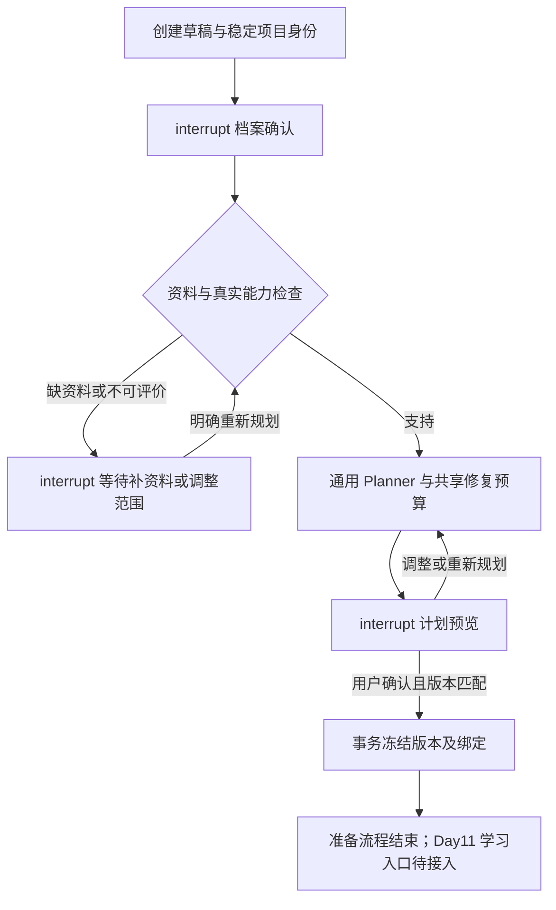

# Day 10：资料与计划准备接口

日期：2026-10-16；修订：2026-10-19。依据仓库上级的《SkillTree 通用学习 Agent 架构说明 V3.0》。本轮接到独立 `app/v3/`，保留 V2 的教学、评分、Diagnosis、网页与持久化行为。Day 9 文档是历史基线；当前 schema 为 `v3-day10-2`，Graph 为 `v3-day10-preparation`，contract 保持 `3.0.0`。

## 运行与迁移

使用项目现有环境，无新增框架或依赖。先停止 V3 写入。首次使用新目录：

```powershell
& 'D:\conda_envs\edu_agent\python.exe' -X utf8 day10_storage.py --root data/v3
```

已有 Day 9 或 Day10-1 V3 目录须显式迁移，并指定尚不存在的备份目录（参数名沿用原脚本）：

```powershell
& 'D:\conda_envs\edu_agent\python.exe' -X utf8 day10_storage.py --root data/v3 --migrate-day9 --backup work/day10/my-day9-backup
```

本机 `data/v3` 已升级为 Day10-2，不需要再运行该升级命令。初始化函数不会悄悄升级旧库。迁移先只读检查两个库的身份和版本；本次新增重试命令台账与未完成执行记录，不变更 V2。Day9 的不同版本 Graph 若有 Checkpoint，仍拒绝换标签。Day10-1 的 Graph 版本兼容，保留全部 Checkpoint 原文，并为旧版中断步骤补建恢复记录。迁移中途退出可重跑，包括元数据已提交但恢复记录尚未补齐的窗口。

准备 API 单独启动，仅绑定本机：

```powershell
& 'D:\conda_envs\edu_agent\python.exe' -m uvicorn app.v3.preparation_api:create_preparation_app --factory --host 127.0.0.1 --port 8003
```

本轮仅交付准备后端，可在 `/docs` 试用。V2 网页不会因此变成通用学科界面，完整前端按 Day 12 接入。SDK 沿用本地受保护 `.env`，timeout=45、max_retries=0；API 不接受模型地址、密钥、任意工具或能力注册字段。

## 资料与上下文

`MaterialService.import_text` 接收粘贴文字；`import_upload` 接收上传字节和单纯文件名，仅 UTF-8 TXT/MD/Markdown，不读用户提交的本机路径。保存原文、源 SHA-256、来源说明、信任说明、可见性、版本和完整行片段。CRLF/BOM 保存在原文哈希中，片段按规范化行模型定位。单文件上限 128 KiB，项目累计资料 1 MiB。

同项目 request_id 的同一导入返回原版本；同身份改内容冲突。新 request、相同来源和内容复用；内容或元数据改变生成新版本，事务内递增 draft_revision。分配版本、存片段、去重与草稿失效同事务完成。每个来源只将最新版本放入草稿目录，不能从新私有版本回退到旧公开版本。

`ContextBuilder.for_teaching(project_id,node_id,objective_id)` 仅取明确绑定的教学片段。`for_assessment`/`for_grading` 是受信服务内部入口，可取对应用途的私有绑定；浏览器没有 purpose 任意选择入口。`V3Repository.freeze_plan(...,material_links=...)` 支持受信调用者提交经验证的 assessment/grading 私有绑定；默认准备 Graph 只冻结 Planner 的教学绑定，后续出题或评价不得因此自行读取所有私有资料。

每次读取验证项目、节点、目标、真实原文行号、哈希、用途及冻结来源清单。相同 node_id 不能跨项目取资料。公开引用仅包含 teaching；公开资料列表及页面不返回原文、私有标题/答案或内部状态。按调用构建完整 JSON 数据消息，合计上下文上限 24,000 字符，不能放下时明确拒绝，不截断出虚假的完整引用。资料内容不成为系统指令，不可新增工具、改策略或取消服务端上限。

词汇命中只提供保守相关性筛查；标题匹配、可定位和哈希正确都不能证明学术支持关系。缺失、无关或冲突内容仍需模型报告和人工抽查。没有向量库，没有升级 V2 固定 Python 字典；V3 统一走新接口，Day 11 接 Tutor 时继续复用。

## 准备 Graph 与确认身份



所有调用/恢复 config 均使用稳定 project_id=thread_id、recursion_limit=30、同步 Checkpoint。等待节点只有 interrupt，无 HTTP 或业务写入。纯 GET 只读取业务事实，不调用模型或恢复 Graph。

| 接口 | 输入要点 | 行为 |
|---|---|---|
| POST /projects | UUID request_id、LearningProfile | 创建幂等；未确认不调用 Planner |
| GET /projects/{id} | 项目身份 | 公开投影、当前 draft_revision、允许动作 |
| POST /projects/{id}/sources | UUID、source_id可省略、标题、来源、可见性；content 或 filename+data_base64 | 导入事务，不运行 Graph |
| GET /projects/{id}/sources | 项目身份 | 仅公开资料元数据 |
| POST /projects/{id}/resume | UUID、pending_input_id、draft_revision、action及匹配载荷 | 显式确认/调整/重新规划/休息 |
| POST /projects/{id}/retry | UUID、retry_token、retry或continue_with_new_budget | 继续技术失败，不新建无限预算 |
| GET /capabilities | 无 | 真实注册表，无 Fake 开关 |

创建示例（后续操作应复制响应中的身份，不自行拼等待身份）：

```json
{
  "request_id": "1cbab13c-7c33-4b94-9446-5c8124fd774b",
  "profile": {
    "subject_label": "开放主题",
    "topic": "依据指定资料辨认规则",
    "goal": "仅做选择辨认",
    "bounded_goal": "从给定选项中选择资料支持的规则",
    "requested_capabilities": ["choice_exact"]
  }
}
```

动作载荷：confirm_profile/confirm_plan/replan/choose_exploration/rest 无附加字段；update_profile/adjust_scope 要完整 profile；adjust_plan 要 feedback。用户不能伪造 profile_version 或 assessed_evidence。错误输入在进入 Graph 前拒绝为 422，原等待点保留。

上传使草稿世代变化后，业务投影立刻 requires_replan，并移除 confirm_plan。旧 revision 确认返回 `409 + requires_replan=true`，即使没有 resume Graph。明确 replan/adjust_plan 才生成新确认身份。确认时再次检查目标、DAG、能力、真实来源、策略与版本，原子保存不可变快照和正式节点。

策略由服务端按请求能力创建：总分及必要目标底线均 0.8，critical 必须阻断，3 轮有效测评、最多追加一次 3 轮、系统换题最多 2 次。模型不输出 policy。确认后资料/策略不能原位覆盖，应派生新项目。冻结完成返回 page_state=learning，但 learning_runtime_ready=false 且 allowed_actions 为空；不启动 Tutor、出题、评分、Diagnosis 或写通过记录。

## 有限调用和恢复

复用共享 ModelCallBudget：单逻辑调用最多 3 次 HTTP，网络重试最多 1 次，结构及业务输出修复合计最多 1 次。持久化 operation 在 HTTP 前预占，进程重启也不返还次数；普通技术 retry 保留该 operation。操作默认 12 次，预算耗尽后只有显式继续可以增加一个子 operation，累计上限 24。SDK 不另做重试。

Planner 接收已确认档案、范围、自述基础、真实教学目录、策略和能力表。同一实现可产生 1–20 节点，每节点最多 5 目标；校验 DAG、先修、目标可观察性、来源/能力/证据匹配、预计总时长及单卷覆盖。词汇筛查不是内容评价通过证明。

业务保存早于 Checkpoint 的情况：候选计划复用 candidate_input_id；输入去重台账防止 profile/replan 重复递增；冻结使用 last_confirmation_id 防止重复插入节点。错误发生在冻结前后均可技术恢复。不能确认过期输入，也不能将浏览器 GET 当作重试入口。

2026-10-19 修复后：每次执行在 Graph 前保存原命令，操作系统文件锁保护同一项目；进程突然退出时锁自动释放，数据库中的执行记录保留。GET 仅做业务只读及锁探测，返回 execution_status=active/interrupted/idle 和 recovery_required。active 状态不允许另一个执行者进入；interrupted 提供 retry，由 POST /retry 接续原 operation、命令和 Checkpoint；已保存候选不会再生成，已冻结节点不会再插入。候选计划写库但 Checkpoint 尚未收敛时，页面暂不提供确认。不能仅凭 running 或经过一段时间就重入。

普通 retry 与 continue_with_new_budget 都持久化 request_id 和载荷指纹。相同已接受命令重发只返回现有状态，不再推进 Graph；同身份改载荷409。若该次重试本身突然退出，重发原身份只查看中断状态，用户以一个新的重试身份显式恢复。预算追加先保存命令台账，子 operation 的创建和恢复均幂等，普通恢复不会额外追加。

超过资料目录或完整 Planner 上下文上限时进入 materials_required，保留 ContextBudgetExceeded 原因；公开 import_material / adjust_scope / replan 可用于替换或缩减资料、重新确认范围并明确规划。不会静默截断资料，也不会把确定性的超限问题困在技术重试中。中断执行需要先恢复收敛，再编辑资料。所有资料返回路径按 line_start、line_end、chunk_id 排序。

## 验收和后续

`day10_demo.py --output 新目录`：三个完整主题的隔离 Fake 契约演示，模拟确认而非用户批准；从教学资料生成公开引用。demo_only 库被真实服务拒绝；没有把 Fake 注册进服务。

`day10_preview.py --output 新目录`：真实 Planner 仅对明确缩小为 choice_exact 的目标生成待确认计划；不冻结、不评价案例、不读取私有答案，不能据此声称完整主题已可正式开课。

`day10_check_fixtures.py`：36 例的离线哈希、划分、来源、量规和有限答案见证检查；不是评分器、人工金标准或真实模型质量指标。三科完整课程的 text_rubric/numeric_scalar 仍为 planned，真实服务须拒绝正式权限，Day 11 实装后复验。
